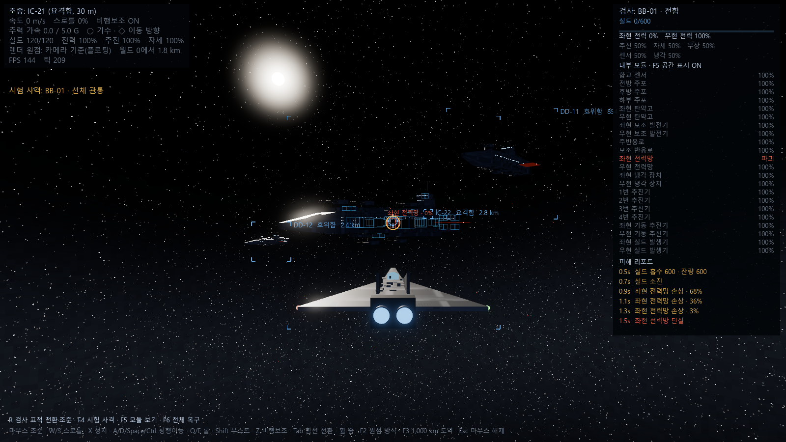
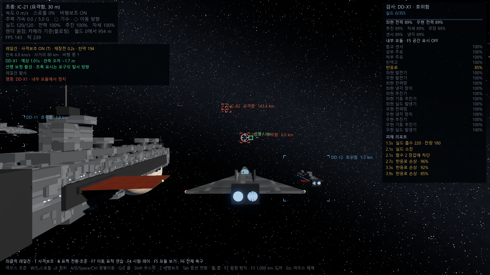

# Project Fleet — 개발 계획

3D 우주 함대전. 초장거리 센서·전자전에서 시작해 포격전, 모듈 정밀타격, 근접 난전으로 좁혀 가는 15~20분 전투.

## 확정된 결정

| 항목 | 결정 | 이유 |
|---|---|---|
| 엔진 | Godot 4.7 (.NET) | 우주 장면은 Godot이 약한 지형·식생·GI가 거의 없다. 가볍고 텍스트 기반이라 반복이 빠르다. |
| 언어 | C# | 탄도·센서·모듈 피해 등 시뮬레이션 비중이 크다. 정적 타입과 성능이 필요하다. |
| 멀티플레이 | 나중에 | 7단계(버티컬 슬라이스)까지는 AI전으로 재미를 먼저 검증한다. |
| 시뮬레이션/연출 분리 | 0단계부터 | `src/Sim`은 Godot 노드에 의존하지 않는 60Hz 고정 틱이다. 나중에 서버 권한형으로 옮길 때 이 층만 서버에서 돌린다. |
| 좌표 | 시뮬레이션 double, 렌더 float | 매 프레임 렌더 원점(조종함)을 빼서 float로 변환한다(연속 플로팅 오리진). 노드를 주기적으로 옮기는 방식보다 단순하고 튀지 않는다. |
| 스케일 | 1 유닛 = 1 m | 전함 1,200 m, 호위함 300 m, 요격함 30 m, 드론 약 6 m. |
| 피해 판정 | 물리엔진 대신 직접 계산 | 레이를 단계별로 진행하며 내부 모듈 볼륨과 교차 판정한다. "2번 추진기 파괴" 같은 결과를 제어하려면 필요하다. |

## 단계

### 0. 기술 검증 — 완료 (2026-10-04)

목표: 1 km 전함 옆을 30 m 요격함이 날 때 "크다"는 느낌이 나는가, 큰 좌표에서 정밀도가 버티는가.

- [x] Godot 4.7.2 .NET + .NET 8/10 SDK 환경, 독립 저장소
- [x] 시뮬레이션 층: `Vec3d`, `ShipBody`(6DOF, 비행보조, 각가속 제한), `SimWorld`(60Hz)
- [x] 두 틱 사이 보간 + 카메라 기준 렌더링
- [x] 마우스 조준 추적 카메라, 수평선이 조종함 롤을 따라감
- [x] 함종 3종의 기동 특성(전함 180° 롤 약 20초)
- [x] 절차적 함선 외형: 패널 무늬, 그리블, 현창 조명 열, 엔진 화염, 상·하부 다른 포탑 배치
- [x] 전함 주위 드론 무리, 150 km 밖 적 함대, 원경 가스 행성(시야각 유지 임포스터)
- [x] HUD: 조준선, 기수 표시, 원거리 표적 브래킷(겹침 정리)
- [x] F3 1,000 km 도약 후에도 정상 렌더링(스크린샷으로 확인)
- [x] 직접 조종해 보며 조작감·스케일감 확인 (1단계 조작감 조정에서 사용자 확인)
- [x] F2로 월드 0 고정 렌더를 켜고 1,000 km 지점에서 떨림이 보이는지 확인 (사용자 확인)

알아낸 것:
- 카메라 원거리 평면을 2억 m로 잡으면 Godot 라이트 컬러의 절두체 계산이 깨져 장면이 사라진다. 1,000 km로 두고, 그보다 먼 천체는 같은 시야각으로 당겨 그린다.
- AgX 톤매핑은 밝은 발광을 흰색으로 몰아서, 뒤에서 본 엔진이 쉽게 포화된다. 정지 상태의 짧은 화염은 숨긴다.

### 1. 조종감 — 기본 구현 완료 (2026-10-05)

요격함 6DOF 마우스 비행, 전함의 느린 선회와 롤, 호위함의 중간 감각을 실제 플레이로 조정한다. 충돌(최소한 함선끼리)을 넣는다.

- [x] 비행보조 ON: 속도·횡추력에 따른 선회율 제한, 큰 선회 입력에 자동 감속 후 재가속
- [x] 합산 병진 가속도 상한: 요격함 5G, 호위함 2G, 전함 0.5G. 제동·횡추력·부스트 포함
- [x] 비행보조 OFF: 기수와 이동 방향을 독립적으로 유지, 무추력 관성 보존
- [x] HUD에 G, 선회 감속 상태, 실제 이동 방향 표시
- [x] `tools/check-sim.ps1`: 실제 시뮬레이션 코드로 합산 G, 속도별 선회, 180도 선회, 보조 OFF, 평행이동·후진·정지 검증
- [x] 실제 플레이로 조작감 조정 (사용자: 이전보다 훨씬 나아짐)
- [x] 비행보조 방식 비교(V): 항공식(기수 선회를 속도에 묶음, 기존) ↔ 우주식(기수 자유, 횡추력 우선 정렬)
- [x] 이동 방향 단서: 우주 먼지, 진행 ◇·역진행 ⊗, 화면 밖 화살표, 1~5초 예측 위치, 미끄럼 각도·정렬 예상 시간
- [x] 두 방식을 실제로 타 보고 기본 방식 결정: 우주식 (사용자, 이동 방향 단서로 알아보기 쉬워짐)
- [x] HUD를 도형·게이지 중심으로 재구성: 조준선 탄약·재장전 호, 계기판(속도·미끄럼 다이얼·G), 계통 막대, 표적 상면·측면 도면

비행 방식 메모(2026-10-05):
- 처음 구현(기수 자유, 횡추력만으로 이동 방향 정렬)은 기수를 돌렸을 때 실제 이동 방향을 알기 어려워 항공식으로 바꿨다.
- 원인은 기수 자유 자체보다 이동을 체감할 배경 단서가 없었던 데 있다고 보고, 우주식을 단서와 함께 다시 넣어 비교한다.
- 우주식의 고속 미끄럼 시간은 5G 한계의 물리량이라 줄일 수 없다(380 m/s 90° 정렬 약 10초). 대신 그동안 기수는 이미 표적을 향한다.
- [x] 함선 간 충돌: 주선체·함교·날개·방열판의 복합 OBB, 연속 이동 구간 검사, 질량별 비탄성 반응과 마찰
- [x] 충돌 HUD: 상대 함선, 접근 속도, 충돌로 인한 속도 변화
- [x] 고속 통과·동시 접촉·회전 접촉·초기 겹침·지속 추력·1,000km/1,000,000km 좌표에서 충돌 검증

첫 조정의 계산 검증(요격함, 스로틀 100%, 180도 목표 방향):
- 초기 100 m/s → 기수와 이동 방향이 새 방향으로 정렬되기까지 약 3.55초
- 초기 380 m/s → 약 10.20초, 최저 속도 약 17.5 m/s
- 초기 760 m/s(부스트) → 약 20.50초
- 보조 ON에서는 위 조건에서 뒤로 날아가는 구간 없이 감속하며 회전한다. 5G 한계에서 고속 반전은 시간이 걸린다.
- 병진 G만 제한하며 승무원 위치의 회전 가속도는 아직 다루지 않는다.

충돌 구현:
- 외부 틱은 60Hz, 충돌과 자세 변화는 240Hz 하위 틱으로 계산한다. 렌더 보간은 전체 60Hz 틱의 양 끝을 사용한다.
- 질량 기준값: 전함 1.2e10 kg, 호위함 1.5e8 kg, 요격함 1.2e5 kg. 게임 조정용 값이다.
- 충돌 없는 근접 통과는 그대로 허용한다. 깊은 초기 겹침은 전체 선체 외곽으로 분리한다.
- 회전하는 부품의 접촉면 속도도 반응에 반영한다. 충격으로 생기는 각속도 변화는 아직 구현하지 않았다. 큰 충격의 내부 모듈 피해는 2단계에서 연결했다.
- G 상한은 추진기에 적용하며 충돌 충격을 제한하지 않는다.
- `tools/check-sim.ps1`: 기동 38개 + 충돌/월드 73개 검증 통과. 월드에서 380 m/s 180도 선회 약 10.23초.

### 2. 피해 모델 — 기본 구현 완료 (2026-10-05)

- [x] `data/ships/*.json`: 기동, 충돌 선체, 실드, 면별 장갑 두께·경사, 내부 모듈 배치(센서, 주포, 탄약고, 발전, 반응로, 냉각, 추진기, 전력망, 실드 발생기)
- [x] 데이터 검증: 양의 크기·질량·체력, 모듈의 선체 내 배치, ID와 추진기 번호 중복 검사
- [x] 실드 흡수와 피격 후 지연 회복, 발생기·전력·냉각에 따른 성능 저하
- [x] 입사각·장갑 경사 → 관통력 소모 → 내부 모듈의 경로 순 피해 → 출구 장갑
- [x] 좌현·우현 전력망과 반응로·보조 발전의 중복성, `좌현 전력망 단절` 같은 피해 리포트
- [x] 모듈 피해를 추진·자세 제어·부스트·실드 회복·개별 엔진 화염에 연결
- [x] 고에너지 탄약고·반응로 파괴 시 낮은 확률의 치명 파괴. 함선·사격 순번을 기준으로 재현 가능한 판정
- [x] ~~큰 충돌의 속도 변화로 접촉점 근처 3개 모듈에 피해~~ → 충돌 에너지 기준으로 교체(2026-10-05): 양쪽 선체 모두 피해, 구조 한계 초과 시 붕괴, 미만이면 접촉점에서 장갑·모듈 관통 계산으로 파쇄(실드 무시), 작은 함선일수록 크게 부서짐
- [x] 반응로가 숨은 HP 막대가 되지 않게 수정(2026-10-05): 발전 여유 25%, 발전 모듈 출력 2단계(정격·50%·0), 양현 공용 장비는 살아 있는 전력망에서 급전
- [x] R 검사 표적·조준, F4 시험 사격, F5 모듈 공간 표시, F6 전체 복구, 시스템별 상태·모듈별 체력·피해 리포트 HUD
- [x] Godot 장면 검증: BB-01 좌현 전력망 관통 → 좌현 0%, 우현 100%, 추진·자세 50%

구현 범위:
- F4 즉시 레이는 피해 검증용이다. 레일건 탄도·발사 제한·사격통제는 3단계에서 연결했다. 실제 탐지·식별은 5단계에서 진행한다.
- 장갑은 입사각·데이터 경사의 등가 두께로 계산한다. 도탄·재질별 정밀 탄도는 아직 없다. 충돌 피해와 드문 치명 파괴의 확률·임계값도 게임 조정용이다.
- 격침된 선체는 추진력을 잃고 관성으로 떠다닌다. 충돌과 사격 차폐에는 남는다.
- 선체·모듈 배치는 임시 모델 기준이다. 실제 함선을 제작하며 JSON과 추진기 연출 번호를 함께 조정한다.
- `tools/check-sim.ps1`: 기동 38개 + 충돌/월드 73개 + 피해/데이터 117개, 총 228개 검증 통과.

### 3. 사격 — 기본 구현 완료 (2026-10-05)

- [x] 함종별 JSON 주포 정의: 포구·탄속·재장전·탄약·관통력·사거리·사각·관측 오차, 주포 모듈 연결
- [x] 발사 함선의 속도를 이어받는 실제 탄, double 위치, 240Hz 연속 상대 이동 교차 검사
- [x] 명중 시 기존 실드·장갑·내부 모듈 피해로 연결, 사거리의 최대 비행 시간 후 탄 소거
- [x] 상대 위치·속도의 등속 선행 조준, 재현 가능한 관측 위치·속도 오차와 센서 손상 반영
- [x] 좌클릭 발사, T 사격보조 ON/OFF, 선택 표적 8° 이내에서 선행 보정, 주포 사각·자함 선체 차폐 확인
- [x] 주포·전력·탄약고 손상과 탄약 소진 시 발사 제한, 주포·냉각 상태에 따른 재장전
- [x] 예상 비행 시간·관측 오차·발사 준비·탄약·명중 HUD, 예광과 명중 섬광
- [x] F7 이동 표적 연습, 자동 ON/OFF 비교, F6 피해·주포·탄약·탄 초기화
- [x] 계산 검증: 기동 38 + 충돌/월드 73 + 피해/데이터 117 + 탄도/사격통제 78, 총 306개 통과 (우주식 추가 후 기동 44, 총 312개)
- [x] 사격통제 표적은 살아 있는 적으로 제한, 기본 표적은 가장 가까운 적(이전에는 아군 기함 BB-01)
- [x] Godot 6km 이동 표적 검증: 180 m/s 횡이동, 6발 발사 후 4초 시점 ON 5발 명중·1발 비행 중, 현재 위치 수동 조준은 명중 0발·실드 유지
- [x] Godot 장거리 검증: 1,000km 도약한 좌표에서 150km 횡이동 표적에 전함 레일건 명중, 약 12.5초 비행 뒤 실드 소진·2개 모듈 타격

현재 구현 범위:
- 당시에는 함종별 주포 한 기였다. 현재는 아래의 다포탑 작업으로 전함 3기·호위함 2기와 개별 선행·모듈 조준을 지원한다.
- 탄은 직선 비행하며 발사 후 표적의 가속·선회를 추적하지 않는다. 관측 오차는 실제 센서·전자전 단계 전의 임시 모델이다.
- 첫 선체 명중 시 내부 관통을 계산하고 탄을 소모한다. 여러 함선 연속 관통·도탄·중력 탄도는 아직 없다.
- 이동 선체의 회전은 240Hz 구간 중앙 자세로 근사한다. 탄속·피해량·사거리·재장전은 게임 조정용 값이다.
- 발사의 전력 소비·폐열 누적은 다음 단계에서 붙인다.

### 4. 전력·폐열 — 기본 구현 완료 (2026-10-05)

- [x] 채널 4개(추진·실드·무장·센서), 핍 8개 0~4 배분, 1~4 키·0 균형. ECM은 5단계에서 채널로 추가
- [x] 핍별 성능 0.3·0.65·1.0·1.25·1.5배, 소비 0.15·0.5·1·1.5·2배. 채널은 활동할 때만 전력을 끈다
- [x] 발전량(반응로·발전기 출력 단계)과 전력망 연결(버스)을 분리. 수요 > 가용이면 모든 채널 비례 전압 강하. 2단계 임시 "발전 여유 25%"를 대체
- [x] 폐열: 소비 전력 = 발열, 레일건 발사 열, 냉각 모듈 방열, 과열 시 전 채널 절반·발사 불가, 70%에서 회복
- [x] 부스트의 대가를 냉각 배율에서 폐열로 변경. 냉각 손상은 추력을 직접 깎지 않고 열이 빠지지 않게 한다
- [x] 보조 추진기 단가 분리: 횡·상하·제동·후진 가속은 메인의 30% 전력. 미끄럼 보정 순간 피크 114% → 38%(요격함)
- [x] HUD 소비 막대·수요선 약 0.3초 평활화
- [x] 보조 추진기 시각화: 전 함종 같은 배치(함수·함미 좌우 1·상하 2씩, 함수 역추진 2), 병진·피치·요·롤에 맞춰 분사
- [x] HUD: 발전·수요 막대, 채널 핍과 소비 막대, 열 막대(회복선·과열선·상승 표시), "과열"·"전력 부족" 칩
- [x] 검증: 전력/열 28개(핍 규칙, 채널별 1.5배 효과, 보조 추진기 단가, 전압 강하, 과열·회복, 냉각 손실), 총 351개 통과

조정 기준(게임 조정용 값):
- 요격함 부스트·연사·실드 재충전 동시 → 약 20초 과열, 회복 약 6초. 부스트 단독은 지속 가능. 냉각 전손 시 대기 약 90초 과열
- 전함 주반응로 상실 + 모든 채널 최대 활동 → 공급 약 73%
- 열 용량/냉각: 요격함 600 MJ/42 MW, 호위함 4,500 MJ/330 MW, 전함 20,000 MJ/1,500 MW

### 5a. 센서·전자전 — 기본 구현 완료 (2026-10-06)

- [x] 진영별 센서망(0.25초 갱신, 데이터 링크 공유): 미탐지 → 접촉 → 식별 → 잠금, 하강 히스테리시스 80%
- [x] 신호 = 관측 세기 × 표적 신호 ÷ km². 표적 신호는 크기·엔진 출력·열로 커진다
- [x] ECM을 다섯째 전력 채널로(기본 0핍). 식별·잠금 신호를 나누고, 대신 접촉 신호는 키운다. 센서 핍이 ECCM 역할
- [x] 사격통제는 잠금일 때만 해를 내고, 방해·신호 세기로 오차 배율(√(1+방해), 강한 신호면 최대 ½)
- [x] HUD: 접촉 "?"·오차 원, 식별 브래킷, 잠금 마름모, 방해 물결, 표적 패널 탐지 단계 막대·"미식별 접촉", 전력 패널 ECM 칸, "ECM" 칩
- [x] 적 전함·호위함 기본 ECM, 미탐지 적은 R로 선택 불가
- [x] 접촉 표시 안정화: 추정 오차가 0.15Hz로 천천히 흐름(4Hz 갱신마다 수 km 튀던 문제), 겹친 접촉 묶음 표시("? ×3")
- [x] 검증: 센서/EW 25개(단계 거리, 데이터 링크, ECM·ECCM, 신호, 히스테리시스, 센서 파괴, 사격통제 연동, 월드 갱신), 총 376개 통과
- [x] Godot: 150 km 시작 시 적은 접촉만, 90 km 전함 대 ECM 전함은 식별 → 센서 4핍으로 잠금, 50 km 잠금 사격 명중

거리 기준(조정용): 전함 센서 1150, 호위함 800, 요격함 60 / 신호 전함 100, 호위함 20, 요격함 3 / 방해 전함 2, 호위함 3, 요격함 1

### 5b. 미사일·디코이·근접방어 — 기본 구현 완료 (2026-10-06)

- [x] 미사일: 접촉 이상 표적에 발사, 센서망 중간 유도 → 탐색기 종말 유도(신호 ÷ ECM, 0.5초마다 재선택), 비례항법, 연소·관성, 근접신관 → 기존 관통 피해
- [x] 함종별 데이터(`missiles`·`pointDefense`·`decoys`), 무장 채널 재장전, 발사 열, 탄약고 손상 시 발사 불가, F6 초기화
- [x] 디코이: 신호 2.5~3배에서 꺼짐, 탐색기를 신호 비율만큼 끌어감
- [x] 근접방어: 포대별 자동 사격, 거리·가로지르는 속도·센서·무장 채널 명중률, 미사일 체력, 아군 함선 상호 방어
- [x] 우클릭 미사일, C 디코이, F8 미사일 훈련(적 호위함 6발), HUD 미사일 표시·경보·잔량 호, 3D 화염·디코이·예광·폭발
- [x] 검증: 미사일/근접방어/디코이 18개(정지·가로지르는 표적 명중, 근접방어·디코이 효과, 발사 규칙, 1e9 m 좌표), 총 395개 통과
- [x] 전함 방어 드론의 탄체 요격: 2026-10-08 AM 작업에서 추가. 독립 HP·관제·발진/회수는 후속.

알아낸 것:
- 한 척이 4~5초 간격으로 한 발씩 쏘면 전함 근접방어가 모두 막는다(F8 훈련 6/6 요격). 뚫으려면 여러 척 동시 일제 사격·디코이로 탐색기를 흔드는 운용이 필요하다. 6단계 AI에서 일제 사격을 다룬다.

### 6. 함대 지휘·AI — 기본 구현 완료 (2026-10-06)

- [x] `src/Sim`의 함선 AI(ShipBrain): 명령(호위·공격·위치 유지), 센서망 정보만 사용, 0.25초 판단 + 매 틱 조종
- [x] 이동: 대형 자리 유지, 함종별 대치 거리·요격함 공격 기동, 충돌 회피(10초 최근접 예측), 잠기지 않으면 접근
- [x] 사격: 레일건(잠금·비행 시간 기준·아군 사선 확인), 미사일 일제 사격 창(합류 대기), 디코이, 전력 자동 배분(근접방어·ECCM·과열 시 ECM 끔)
- [x] 함대 지휘관: 함종별 표적 선호·분산 배정·무력화 적 후순위, 호위함은 사거리 전까지 기함 호위
- [x] 플레이어 편대: G 공격·H 호위·J 위치 유지, Tab 전환 시 AI 인계, HUD 명령 선·칩
- [x] 시간 배속 ×1·×4·×16, 무력화 상태(발전 없음 또는 추진·자세 전손)
- [x] 검증: AI/함대 18개, 총 413개 통과
- [x] 편대 편성(2026-10-06): 진영마다 전투단(BB+DD2)·호위 전대(DD4)·요격 편대(IC5), 역할별 행동(대치 포격+근접 호위 / 측면 기동·방공 복귀 / 경계·요격·집결 후 동시 돌격), 플레이어는 탄 함선의 편대만 지휘, 편대 현황 HUD
- [x] 근접방어 약화: 단독 호위함 6발 중 5발 요격 → 2발, 전투단 8발 일제 사격 3발 요격·5발 명중. 미사일 명중률(전면전) 약 5% → 약 45%
- [x] 검증 432개 통과. 24척 20분 전면전에서 약 절반이 격침·무력화
- [x] 요격함 침투(2026-10-06): 근접방어 포대 사계(전함 배면·후미 아래 사각), 근접방어의 대요격함 사격, 방열판 냉각 모듈, 부위 조준(Y·AI 공용)과 관통 미리보기, AI 후미 아래 우회 침투, 모듈 피해식 수정(현 길이 기준). 검사 444개
  - 혼자 둔 전함은 요격함 1척에 4분 안에 추진 0%. 전투단 호위함의 사각 엄호가 실제로 중요해졌다
  - 전면전 24척 중 15척 격침·무력화, 처음으로 전투단 전멸 발생. 아군 쪽이 일관되게 불리한 비대칭이 있다(배치 고도 차이 등, 7단계에서 확인)

알아낸 것(7단계 밸런스 과제):
- (편대 편성 전) 20분 안에 전함·호위함이 격침되지 않았다. 근접방어 약화·편대 행동 뒤 호위 전대·요격 편대는 10~15분에 소모되지만, 양쪽 전투단은 60 km 대치에서 끝까지 남는다. 관통 탄의 상당수가 모듈 없는 빈 공간을 지난다.
- ECM 양측 사용 시 30 km 대치에서도 호위함끼리 식별이 어렵다. AI의 ECCM 대응이 교전 양상을 크게 바꾼다(작은 변경에도 레일건 사격 수가 수배 차이).
- 편대 공격 명령을 내리면 빠른 요격함이 먼저 적 함대에 뛰어들어 몇 분 만에 무력화된다. 함종별 명령 분리나 "편대 속도 맞추기"가 필요할 수 있다.

### 함종별 조작 체계 (2026-10-06)

- [x] 1차: 요격함 마우스 조함 유지, 호위함·전함 키보드 요·피치·롤, Alt 평행추력, 함선 추종 카메라와 중클릭 자유 관찰. `HelmForward`와 직접 각속도 입력 분리.
- 검증: 기존 444개 + 조함 6개. AI 전투 기준 결과 비교, DD 요·BB 롤 스크린샷.
- [x] 2차: AI·플레이어 공용 자동 사격, 5개 교리, 모듈·브래킷 클릭 선택, 커서 수동 사격, 사격 HUD와 선체 가림 경고.
- 검증: 자동 사격 10개 추가, 총 460개. 전함 아래 8 km 표적은 발사 0, 롤 후 발사. AI 전투 기준 결과 동일.
- [x] 3차: Helm T 교리 순환과 짧은 알림, Pilot T 사격보조 유지. 빌드·460개 검사·교리 HUD 화면 확인.
- [x] 4차: 공용 라디얼 계산·단일 실행 수명·섹터 HUD, F 전력 프리셋, 캡처/자유 커서, 클릭 차단과 취소, 검증 CLI와 도움말 구분.
- 검증: 라디얼·전력 33개 추가, 총 493개. 화력 선택 1/1/4/2/0, 중앙 취소 2/2/2/2/0, 두 조작 방식 화면 확인. 직접 조작감은 미확인.
- [x] 5차: B 교리·일제사격, N 호위/요격/집중/복귀/위치유지 라디얼. 2초마다 근처 요격함 분산 배정, 복귀 시 공격 해제, 내 편대 HUD 갱신.
- 검증: 편대 9개·선택 표적/모듈 우선순위·AI 소유권 5개 추가, 총 507개. 라디얼 무력화 칩과 집중공격 점선 화면 확인. 기존 `--look-at`/`--turn` 관찰 인자도 조함 카메라에서 유지.
- 최종 빌드 오류 0, 신규 컴파일 경고 0. 507개 검사 통과, `Fleet attack`·`Full battle`의 발사/명중/손상 결과가 작업 전 기준과 동일. NuGet 취약성 데이터 조회의 기존 네트워크 경고(NU1900)는 남아 있다.
- 단계별 화면: `shots/helm_yaw.png`, `helm_roll.png`, `gunnery_focus.png`, `gunnery_blocked.png`, `gunnery_rolled.png`, `gunnery_hold.png`, `radial_power_helm.png`, `radial_power_pilot.png`, `radial_power_release.png`, `radial_power_cancel.png`, `radial_disable.png`, `radial_squad_focus.png`.
- 실제 손으로 조작한 조함·카메라·라디얼의 감각은 미확인. 드론·다중 주포·다른 편대 지휘·최종 UI·밸런스는 작업 범위에서 제외.
- [x] 검수 수정: 화면 밖 방향 표시(미사일 채운 삼각형 · 적 함선 빈 화살촉 · 사격 표적 고리, 진행 방향과 띠 분리), 글자 "롤 필요" 대신 사격 방위구(포각·선체 가림 영역과 표적 점)와 표적 ⊘·빨간 선행점, 사격 패널을 계기판 오른쪽으로 옮겨 자함 모델을 가리지 않게 함. 발사 실패 사유를 문구 대신 `FireFailure` 코드로, 무력화 자동 부위에서 내부 냉각기 제외(겉 방열판만), 자율 표적 거리를 센서 추정 위치로, `SquadCommands`를 `src/Sim`으로 이동.
- 검증: 사격 검사 5개 추가, 총 512개 통과. `Fleet attack`·`Full battle` 결과 이전과 동일. 화면: `shots/fx_bb_below.png`(아래 표적 · 방위구 하단 빨강 X), `fx_bb_side.png`(롤 중 · 초록 점), `fx_bb_roll.png`(계속 롤해 다시 가림 · 화면 밖 ⊘), `fx_offscreen.png`(화면 밖 미사일·표적).

### 7. 버티컬 슬라이스

3함종, 24척(진영당 전투단·호위 전대·요격 편대) 한 판. 작업지시서: `WORKORDER_stage7_vertical_slice.md`, 단계별 수치: `BALANCE_stage7.md`.

- [x] 1차: 게임/검사 배치 통합, 시드·Mirror, 전투 기록·승패 규칙, 병렬 40판 CSV. 전체 검사 542개 통과.
- [x] 2차: 일제사격 교착·이름 기반 기동·시작 고도 비대칭 수정, 대형 회전 속도 보정. 40판 42.5/47.5% 승률, 544개 검사 34초 통과.
- [x] 3차 구현: 함대 태세·센서 기반 전력비·정밀타격·교차 대형 수정, 557개 검사24초 통과. 40판 52.5/42.5% 승률·무승부5%. 15~20분 판정/포격 지속/주력함 근접 발생률 목표는 미달이며 BALANCE에 시도별 결과를 남김.
- [x] 4차: Main 시작·3역할 선택·전투·결과·새 시드 재시작, 일시정지·개발 키 잠금·자동 함선 인계, 전력/태세 HUD와 개인 기록. Sim 562개 및 화면 흐름 16개 통과, 40판 결과 3차와 동일.
- [x] 5차: 국면별 틱 프로파일·실제 FPS 자동 관전·판정 후300초 목록 검사·4096 이벤트 상한. Sim572개21.74초, 화면 흐름18개 통과. 단독 한 판 Step 평균0.173ms/p990.938ms, 게임 판정 평균83.19FPS·예외0.

알아낸 것:
- 최종40판 승률52.5/42.5%, 무승부5%, 아군 충돌평균0.10. 판정 중앙값12분36초와 포격≥60초 비율32.5%, 주력함 근접 발생률60%는 목표에 미달한다. 밸런스 조정 시도와 원인은 BALANCE_stage7에 남겼다.
- 결과 기록은 판정 시점에 고정하고, 후속 관전 이벤트는 상한을 둬야 오래 켜 둬도 목록이 계속 늘지 않는다. PNG 저장을 포함한 검증 자동 관전의 누적 최소FPS는4.14로 단발 지연이 있다. 직접 조작감·재미·메뉴 가독성의 사용자 평가는 미확인이다.

### 첫 전투 사운드 (2026-10-07)

- [x] Agent Audio·audio-production 스킬·Codex MCP 설정 설치. 고정 Stable Audio 3 Medium 모델 네 파일의 SHA256 검증 후 실제 stdio MCP로 3초 효과음 세 개 생성. CPU에서 각각 52.39/47.61/40.92초, 관측 메모리 최고치 9.88/9.62/10.72 GiB.
- [x] 주포 발사·실드/선체 피격·짧은 적 명중 피드백, 7음성 상한·재생 간격·함종 음높이, 조종함 전환/시간 건너뛰기 초기화. M 음소거·일시정지 음량 조절·설정 저장·재생 일시정지.
- 검증: 빌드 경고/오류 0, 기존 Sim572개·화면 흐름18개·실제 무기와 믹서 출력27개 통과. 원본/게임용 WAV 모두 44.1kHz 스테레오 PCM16, 무음·클리핑 없음. 일시정지 음량 화면 `shots/audio_pause.png` 확인. 소리 질감의 직접 청감 평가는 미확인.
- 모델 데이터는 저장소 밖에 보관하고 원본·프롬프트·측정값·다듬은 WAV·체크섬을 `assets/audio/`에 남겼다. 엔진 루프·미사일 발사·전장 배경음은 후속 작업.

### 타격·피격 피드백 (2026-10-07)

- [x] 레일건·미사일·근접방어 명중에 입사 방향·에너지·실드 붕괴·격침 당시 결과를 기록. 물리와 피해 계산은 보존.
- [x] 화면·소리 공통 분류: 실드 흡수 / 장갑 방어 / 관통 / 모듈 파괴. 발사 ID가 작은 미사일의 늦은 도착도 누락하지 않으며 아군 오사는 적 명중 확인에서 제외.
- [x] 방향 호·화살표, 상하/좌우/전후 표시, 피격 결과·손실 모듈 문구. 원거리 명중 마커의 모양·문구·센서 표적 표시 반응.
- [x] 함종별 감쇠 시간(요격함 0.36초 / 호위함 0.52초 / 전함 0.70초), 연타 상한 1.8도, 화면 연출만 적용. 조준선은 실제 사격 방향을 화면에 투영.
- [x] 일시정지 메뉴에 흔들림 0~100% 저장 설정(기본 75%). 일시정지·함선 전환·관전·시간 건너뛰기 시 오래된 효과 제거/정지.
- [x] 기존 Agent Audio 음원에서 방어·관통·파괴 효과음 3개 파생. 총 11음성 제한, 기존 음량/음소거/리미터 적용.
- 검증: 빌드 오류/경고 0, Sim 572개, 피격 연출 42개, 실제 오디오 믹서 32개, 화면 흐름 18개 통과. 믹서 피크 0.311, 파생 WAV 모두 무음·클리핑 없음. `shots/feedback_critical.png`, `shots/feedback_pause.png`에서 HUD·설정 배치 확인. 직접 청감과 플레이 감각 튜닝은 미확인.

### 자유 관찰 복귀와 구형 레이더 (2026-10-07)

- [x] 중클릭 해제 시 현재 상대 관찰 시점 3초 유지 후 감쇠 복귀. 다시 누르면 유지 취소, 일시정지는 타이머 정지, 함선 전환은 초기화. 전투 배속과 무관한 실제 화면 시간 사용.
- [x] 좌상단 구형 3D 전술 레이더: 자함 기준 전방·상부 축, 전후 반구, 기준면과 높이선, 아군·적·미식별 구분, 선택 표적 거리/높이.
- [x] 센서 미탐지 제외와 추정 오차 반영, double 상대 좌표 후 변환. 2/10/50/200/500 km 선형 축척, 범위 밖 표적 표시, 공간상 가까운 밀집 점 집계.
- [x] PgUp/PgDn 및 지도 위 휠로 범위 변경, 지도 좌클릭 선택. 지도 입력과 수동 사격·카메라 줌 분리. F1 도움말과 지도 겹침 방지.
- 검증: 빌드 오류/경고 0, 시점·레이더 28개, 기존 피격 연출 42개, 화면 흐름/입력 21개 통과. 실제 전투 HUD `shots/radar_initial.png` 확인. 시뮬레이션과 음원은 이번 변경에서 수정하지 않음.

### 독립 구형 레이더와 전장 전체 지도 (2026-10-07)

- [x] 레이더 사각 패널·제목·범례·상세 문구를 제거하고 구만 표시. 원형 영역 클릭 또는 M으로 전체 지도 열기.
- [x] 전장 절대 좌표의 입체 전체 지도. 처음 열 때 알려진 모든 접촉을 포함, 지도 중심·축척은 자함 이동/전환에 따라가지 않으며 다시 열어도 유지.
- [x] 좌/중드래그 이동, 우드래그 회전, 커서 기준 휠 확대, Home 전체 보기. 함선 클릭 정보, 센서 미탐지/미식별 보호, 추정 오차와 세계 Y=0 높이선.
- [x] 지도 중 전투 지속·직접 조작 입력 차단, Esc는 지도부터 닫기, 조종사 마우스 캡처 복원과 닫기 클릭 발사 방지. 효과음 토글을 F10으로 이동.
- 검증: 빌드 오류/경고 0, 시점/지도 43개·화면 흐름/입력 32개·피격 연출 42개 통과. `shots/radar_globe.png`(1280×720), `shots/world_map.png`(1600×900) 실제 렌더 확인.

### 전체 지도 구형 표현 보정 (2026-10-07)

- [x] 전체 지도의 평면 격자를 구형 좌표망으로 교체. 앞/뒤 반구 밝기·점선, 위도/경도선, 세계 X/Y/Z축, 적도면 높이선으로 부피와 깊이 표시.
- [x] 전장 기준 중심과 이동/회전/확대 조작 유지. 반경 표시, 구 밖 접촉 개수와 Home 전체 보기 안내. 함선은 구 표면에 붙이지 않고 실제 3D 상대 위치에 표시.
- 검증: 빌드 오류/경고 0, 시점/지도 45개 통과. `shots/world_globe.png`(1600×900)와 `shots/world_globe_720.png`(1280×720) 렌더 확인.

### 소실 접촉 기억과 목표 선택 유지 (2026-10-07)

- [x] 전투별·관측 진영별 접촉 기억. 센서가 접촉을 잃으면 마지막 추정 위치·오차·식별 정보·피해 상태·확인 시각을 동결하고 회색 `신호 소실` 표시.
- [x] 구형 레이더·전체 지도·화면 브래킷·표적 패널·선택 표적의 화면 밖 방향에 적용. 선택 유지, R로 소실 접촉 재선택, 재탐지 시 위치/색 갱신 및 재식별 시 상태 갱신.
- [x] 미탐지 적의 기록 생성 방지, 미식별 접촉의 이름/피해 비공개. 소실 중 실제 위치·상태를 읽어 갱신하지 않고 실시간 센서의 사격 잠금과 분리.
- 검증: 빌드 오류/경고 0, 접촉 기억 22개·시점/지도 45개·화면 흐름/목표 선택 37개 통과. `shots/contact_lost.png`와 `shots/contact_lost_map.png`에서 회색 위치·선택·마지막 상태 표시 확인.

### 레퍼런스 기반 Blender 함선 외형 (2026-10-08)

- [x] 전함·호위함·요격함 원본 3개와 GLB 3개. 분할 장갑, 포대, 미사일 발사부, 센서/ECM, 방열판, 실드, 엔진, RCS. 원본은 부품별 편집 가능하고 게임용 선체·포탑 하우징·포신 그룹을 각각 병합.
- [x] 기존 함종 스케일·무장·피해 모듈 위치 마커와 숨겨진 볼륨 가이드. 엔진·RCS 출력 및 엔진 파손 연결. 물리·피해·전투 수치 유지.
- [x] 진영별 식별 띠·실드·엔진 색상. Blender 제작/렌더 도구와 수작업 수정 후 재생성 없이 GLB만 내보내는 도구.
- 검증: 빌드 경고/오류 0, 실제 모델 255개·그래픽 모드 화면 흐름 37개 통과. 3종 Blender 렌더와 게임 화면 확인. 전함 38,910 / 호위함 32,568 / 요격함 13,208 삼각형, 12/12/10개 재질.
- 후속 아트 작업: UV/표면 질감, 포탑별 손상 외형, 근접방어 외형 회전. 드론 크래들 등 장식은 새 기능을 추가하지 않는다.

### 주포 선회와 다포탑 사격 (2026-10-08)

- [x] 전함 상부 2기·하부 1기, 호위함 상·하부 각 1기. 포탑별 수평·고저 구동, 사격각, 장전·탄약·피해 상태. 요격함 고정 전방포 유지.
- [x] 각 포구에서 자동 선행 조준, 커서 지점 수동 수렴 사격, 실제 포신 방향의 탄도. 선회 미완료·선체/포탑 하우징 가림·자동 사격 아군 사선 차단.
- [x] Blender 원본과 GLB에 yaw/elevation/recoil 계층, 쌍열 교대 발사, 포구 섬광·포신 반동. 총 7/5/1개 메시로 병합하며 삼각형 수 유지.
- [x] 포탑별 HUD, 준비 포만 사격, 주포 하나 파괴 시 나머지 운용, 센서 신호 소실 시 자동 사격 중지.
- 검증: 빌드 경고/오류 0, 모델 431개·화면 흐름 37개·신호 기억 22개·효과음 32개 통과. 전함 측면 표적에서 3기 발사·3발 명중 확인. 전체 시뮬레이션과 전투 결정성 검사 통과.
- 후속 조정: 기존 총 탄약을 분배했지만 시간당 화력·폐열은 증가한다. 이전 단일 주포 기준 40판 밸런스는 다포탑 기준으로 재측정 필요.

### 반물질 강습어뢰 — 초기 구현 (2026-10-08)

- [x] 요격함 일반 미사일 4발과 독립된 AM 2발. 6으로 준비/취소, 2.5초 ARMING, 우클릭 발사, 7초·비행경로 8 km 제한, 6G 종말 유도. ECM·디코이·PD 대응.
- [x] 기존 실드·장갑·모듈 피해 연결, 국소 관통 깊이 180 m. 온전한 전함 실드는 첫 발을 막고 무실드 취약부 명중은 해당 계통을 파괴.
- [x] 전용 격리 모듈 직접 피해에만 유폭. SAFE 건전성 15% / ARMING·ARMED 65% 임계값, 85% 미만 경고. Backspace 1초 유지로 전량 투기, 수리·무장 초기화로 재보급 금지.
- [x] HUD·격리부 발광·짧은 추진광·에너지 섬광·파편, 무해한 소멸/요격 구분. 기존 음원으로 준비/발사/투기 큐 연결. Blender IC 원본과 GLB에 포드·소켓 추가(13,472 tris).
- [x] AI 후미 배면 침투·5 km 발사·6초 이탈, 손상 시 투기, 호위함 위협 우선순위, 전함 방어 롤. 방어 드론 8기 실제 궤도/사격/유한 탄약 연결.
- [x] 별도 발사·명중·유폭·투기 통계, 플레이어 결과 기록. 단독 128회 + Seed 0~3 원본/미러 전면전 8판 CSV 보존.
- 검증: Sim 719개(AM 96개), 모델 435개, AM 게임 통합 20개, 화면 흐름 37개, 음향 32개, 신호 기억 22개. 빌드 경고/오류 0. 실제 HUD 준비·발사·경고 화면 확인.
- 초기 측정: PD·드론이 있는 상부 접근 0/8 명중, 후미 배면 3.5·5 km 각각 5/8. 전면전 총 52발/5명중, 유폭 2회·투기 3회, Blue 1승/Red 7승. 초기 기능 검증이며 밸런스 완료 아님. 상세는 `BALANCE_stage7.md` 마지막 절.
- 남은 범위: AI 침투·발사 각도/시점 및 다포탑·드론 포함 전면전 재조정, 방향별 실드(현재 단일 풀), 독립 드론 피해·관제, 지속적인 함체 파손 외형. 현재 AM 효과는 순간 섬광·파편까지다.

### 반물질 명중률 재검증·비행 수정 (2026-10-08)

- 원인: 어뢰가 모함의 횡속도를 상속한 뒤 합성 속도 방향으로 가속하여 옆미끄럼까지 증폭했다. 200 m/s 횡이동 발사 시 무방어 정지 전함을 728 m 빗나가는 상황 재현.
- [x] 발사 자세 기준 추력, 가속·상속 속도를 함께 푸는 선행 조준, 6G 제한 종말 보정. 표적 부위 회전 속도 반영. AI 준비 중 어뢰 조준, 플레이어 전용 AM 선행점. 사거리·탄수·위력·방공 수치 유지.
- [x] 어뢰별 명중/PD/드론/디코이/수명 종료, 비행시간·최근접 거리·잠금 시간 CSV. 판정 시 비행 중인 탄도 별도 집계.
- 동일 Seed 0~19 원본/미러 각 40판: 명중 47/228(20.6%) → 127/237(53.6%), 수명 종료 63 → 7, 요격 112 → 97. 각 표본 판정 시 비행 중 6발. Blue/Red 승리 20/20 → 21/19. 초기 8판의 1/7은 큰 표본에서 유지되지 않았다.
- 검증: 전체 Sim 767개(AM 144개), 실제 게임 통합 21개, 빌드 경고/오류 0. 횡속도 0~300 m/s로 이동 전함·호위함에 발사하는 검사 추가. 정지 표적 128회는 이전과 결과 동일. AM 선행점 실제 화면 확인.
- 후속 균형은 편성·추가 시드와 플레이로 판단한다. 현재 40판의 포격 국면 부족 및 판정 시간 목표 미달은 남아 있다. 상세·CSV는 `BALANCE_stage7.md` 마지막 절.

### 무기 선택과 망원 입력 (2026-10-08)

- [x] 1 주포 / 2 일반 미사일 / 3 반물질 강습어뢰 선택, 좌클릭으로 선택 무기 발사. 주포 유지 연사, 미사일·어뢰는 클릭당 한 발. 전력 배분은 F 라디얼로 통일하고 이전 숫자 핍·6 AM 입력 제거.
- [x] 어뢰 선택 시 준비, 다른 무기로 바꾸면 SAFE 복귀. 재선택 시 준비 진행 유지. 커서 재획득·무기 전환 중 누르고 있던 클릭의 오발 방지.
- [x] 우클릭 유지 시 광학 4배 망원, 해제 시 부드러운 복귀. 배율에 맞춘 마우스 감도, 휠 거리 보존. 지도·라디얼·일시정지·Esc·함선 인계·포커스 상실 시 망원 해제.
- [x] 선택 무기·잔탄 HUD, 도움말·README 갱신. 작은 화면의 AM 상태창과 무기 선택 표시 간격 확보.
- 검증: 빌드 경고/오류 0, 무기·망원 입력 37개, AM 게임 통합 21개, 화면 흐름 37개, 카메라·레이더·지도 45개 통과. 1600×900 망원 화면과 1280×720 HUD 확인.

### 포탑 표시·고저 조준과 탄약 지속 시간 (2026-10-08)

- 확인: 작은 PD 포탑은 사격 판정만 있고 외형 회전 연결이 없었다. 큰 주포는 기존 코드에서 측면 자동 사격이 재현되었으며, 포구 마커뿐 아니라 실제 포신 메시의 수평·고저 회전 검사도 추가했다.
- [x] Blender 원본의 PD 부품을 보존하며 yaw/pitch/포구 축 추가. 전함 8기·호위함 4기·요격함 1기를 실제 PD 표적·발사 시각과 연결. 수평 540°/s, 고저 360°/s 표현 및 포구 섬광. 기존 요격 확률·판정은 유지.
- [x] 큰 주포 상부/하부 자동 표적 추적, 포신 고저각(-5°~85°)과 실제 메시 방향 검증. 화면에서 수평 약 70°·고저 약 30° 자동 사격 확인.
- [x] 전함 총 120 → 360발(포탑당 120), 호위함 160 → 320발(포탑당 160). 포탑마다 기존 단일 주포 수준의 사격 지속 시간을 갖도록 조정. 재장전·발사 열·요격함/미사일/AM 탄수 유지.
- [x] 실행 전 변경 리소스 임포트 갱신: 기존 .godot 폴더 유무만 확인하던 경로 수정. 임포트 누락을 움직이지 않는 구형 외형으로 숨기는 대체 경로 제거. 로컬 검증 출력 shots/는 임포트 대상에서 제외.
- 검증: 빌드 경고/오류 0, 전체 Sim 769개(포탑 53개 포함), 모델 558개, 화면 흐름 37개, 무기·망원 입력 37개. 탄약 증가 후 장기 승률 통계는 후속 재측정 대상.

### 연장포 동시 사격과 근접방어 구동 한계 (2026-10-08)

- [x] 전함·호위함 연장포 양쪽 포구에서 동시에 두 탄환 발사. 각 탄환의 궤적·충돌·피해·로그·탄약·열을 독립 반영하고 포탑 재장전은 공유한다. 잔탄 한 발 처리 및 양쪽 포신의 자함/아군 사선 차단 검사. 요격함 고정 주포는 단발 유지.
- [x] 전함 720발(포탑당 240), 호위함 640발(포탑당 320). 앞선 포탑별 120/160회 사격을 유지한다. 한 번에 두 발이므로 순간 화력과 발열은 두 배다.
- [x] PD의 표현 전용 회전을 시뮬레이션 구동으로 교체. 전함 수평/고저 60/45°/s, 호위함 90/60°/s, 요격함 120/90°/s. 담당 방위에서 좌우 110°(요격함 100°), 고각 -5~85°, 포신 오차 1.5° 이하에서 발사. 하부 포대·함체 롤·부동 원점·렌더 보간 지원.
- [x] 사거리의 1.5배에서 사전 추적하되 실제 사거리는 유지. 사거리 안 위협이 사전 추적 때문에 방치되지 않도록 우선순위 처리. 추적 실패·사계 이탈·전력/센서 상실에 따른 사격 중단과 누적 발사 방지, 재설정 처리.
- 실측: 전함 PD 한 기의 5초 직선 통과 실험에서 100m/s·최단 약461m는 33발, 1200m/s·약461m는 12발, 1200m/s·약3.51km는 34발. 미사일과 요격함 모두 같은 추적 한계를 보였다. 방공 요격량은 이전보다 감소하며 장기 승률은 아직 재측정하지 않았다.
- 검증: 전체 Sim 957개 및 마지막 표적 우선순위 3개 추가 검사 통과(최종 구성 960개). 포탑 71개·PD 추적 170개·사수 20개 재검증, 모델 571개, 실제 무기·망원 입력 37개, 최종 빌드 경고/오류 0. 기준 전투는 697.23초 Blue 승리·충돌 0, 결과 후 300초 안정성 검사 통과. 포격 분류 0초는 계통 파괴/난전 분류의 우선순위에 따른 것으로, 실제 주포 발사/명중은 Blue 457/354·Red 154/89. 한 판으로 승률 균형을 판단하지 않는다.

### 연장포·PD 밸런스 분리 측정 (2026-10-08)

- [x] 수정 전(e9b2765), 주포만, PD만, 현재의 2×2 조건. Seed 0~19 × 원본/미러 각 40판, 총 160판. 기존 게임 코드는 보존하고 격리 소스로 Release 실행.
- [x] 배치 도구에 판정 시점 함선별 피해·가동·탄약·무장 사용 CSV 추가. 조건 간 동일 시드 비교, 진영/함선 합계 일치 확인, 시드 쌍 부트스트랩. 원본과 집계는 `docs/balance/turret_20261008/`에 보관.
- 현재 Blue/Red 18/22, 중앙값 12:02(기존 21/19·12:15). 큰 진영 편향/시간 급감의 근거는 부족하다. 일반 미사일 명중 64.5→78.3%, AM 명중 53.6→63.9%. 대형함 주포 탄착 8,175→14,001.
- AM 사용 전투 23→19/40, 발사 237→191. 요격함 98.3% 가동, 271/400척이 AM 미사용·보유·가동 상태. 난전 중앙값 102.9→63.3초. 다음 조정은 주포 수치 일괄 하향보다 요격편대의 대함 돌입 시점과 추적 완료 상태의 일반 미사일 방어 효율을 우선 실험한다.
- 상세 방법·분리 조건·표본 한계·후속 제안은 `BALANCE_stage7.md` 마지막 절. 이번 턴에는 전투 수치를 추가 변경하지 않았다.

### 드론 방어구역 운용 (2026-10-08)

- [x] 기존 전함 8기 자동 요격에 플레이어 명령 연결. 4 라디얼: 전방/우현/후방/좌현/전방위. 미탑재 함선 안내, 중앙/Esc 취소, 무기 입력 차단, 망원 해제, 지도/일시정지/포커스 상실 시 명령 취소.
- [x] 모함 기준 90° 방위 구역(상하 포함), 드론 실제 위치·사거리·선체 가림으로 미사일/AM 요격. 반경 900 m 바깥 경로를 최대 240 m/s로 이동하며 반대 구역도 선체 관통 없이 재배치. 60 Hz 위치 보간을 모함과 공유.
- [x] HUD에 방향/실제 위치/재배치/무장 기체/잔탄/요격 수. 자기 드론 마름모 및 사격 링. 센서·발전 상실 시 통제 중지, 수리 후 기존 명령 재개. 명령 변경으로 탄약 보충 없음.
- 기체 수·사거리·발사속도·명중률·탄당 피해는 유지. AI/초기 배치는 전방위. 독립 HP·충돌·요격함 공격·발진/회수는 아직 제외.
- 검증: 전체 Sim 1,036개(드론 76개 포함, 장기 전투 66개는 아래 시간 비교 수정 후 재실행), 실제 게임 무기/망원/드론 입력 62개, 모델 571개, 장면 전환 37개 통과. 빌드 경고/오류 0. 전방 2.5 km 정지 적탄 3초 발사량 전방위 12 / 전방 집중 64 / 후방 집중 0. `shots/drone_radial.png`, `shots/drone_fore_guard.png` 화면 확인. 전체 전투 통계 재측정은 후속이며 위 160판은 기존 자동 궤도 드론 상태의 기록이다.
- 장기 회귀 전투: 935.62초 Red 승리, 판정 후 300초 추가 진행·판정/기록 동결·충돌 0 확인. 기존 검사에서 `Tick/60 >= outcome.Time+300`이 2.27e-13초 반올림 차이로 실패하여 정확히 18,000틱 진행 여부로 검증을 수정했다. 게임 판정/시간 계산은 변경하지 않았다. 단일 회귀 전투는 승률 평가에 사용하지 않는다.

### 드론 대요격함 사격·피해·보조 포탑 대응 (2026-10-08)

- [x] 드론은 미사일/어뢰 우선, 없으면 지정 구역의 적 요격함 사격. 유한 탄창 공유, 실제 위치/속도/사거리/선체 가림, 실드 → 장갑 → 내부 모듈 피해와 기존 피격 피드백 연결.
- [x] 개별 HP 8. PD/보조 포탑 및 주포 직격으로 파괴. 주포는 240 Hz 상대 이동 경로와 반경 4 m 드론 구의 연속 교차를 검사하며 더 가까운 함선이 막는다. 파괴된 드론은 이동·사격·가용 탄약·메시에서 제외하고 섬광/파편 발생. 모함 수리·구역 변경으로 부활하지 않는다.
- [x] 요격함 보조 포탑 자동 대응: 사거리 내 미사일/어뢰 → 드론 → 요격함. 사거리 밖 조기 추적은 실제 사거리 안 표적을 막지 않는다. 후방/하부 사계, 사거리 1.2 km, 최대 수평/고저 90/60°/s, 방위 ±100°, 갑판 기준 고저 -5~85°, 발사 오차 1.5°. 같은 상태로 실제 포신·총구 섬광 구동.
- [x] 드론 생존 수·내구도 표식·요격함 명중 수, 요격함 보조포 추적/사격 상태·드론 격추 수, 기존 음원을 쓰는 격추 확인음. 일반 수리와 명시적 개발용 무장 초기화를 구분.
- 검증: 전체 Sim 1,068개(드론 구역 76 + 전투 32), 실제 GPU 모델 579개, 실제 게임 입력 62개, 믹서 포함 음향 36개 통과. 빌드 경고/오류 0. MultiMesh 변환 저장을 지원하지 않는 헤드리스 대신 모델 검사는 실제 렌더러로 실행한다. `shots/interceptor_drone_hud.png` 확인.
- 단독 시험: 기본 보조 포탑이 HP 8 드론을 6.92초/32발에 격추. 5초 횡단 노출에서 80 m/s는 22발, 1,200 m/s는 2발 발사. 드론 4기 상실 시 같은 노출의 지속 발사량도 절반. 단일 장기 회귀는 666.52초 Blue 승리, 판정 후 300초 추가 진행·기록 동결·충돌 0 통과. 승률 평가는 별도 반복 측정이 필요하다.
- 남은 범위: 드론 발진/회수·함선 간 물리 충돌·개별 선택 명령, 드론 교전까지 포함한 전면전 밸런스 재측정.

### 요격함 후방 상부 보조 포탑 (2026-10-08)

- [x] 기존 하부 0번 포탑을 유지하고 상부 1번 포탑을 `(0, 1.6, 10)`에 추가. 수직 핀 뒤의 갑판에 받침대를 설치하여 선체 밖에서 후방 상부를 방어한다. Blender 원본과 GLB·manifest·JSON 좌표를 함께 갱신. 기존 부품을 보존하는 `tools/fit-interceptor-dorsal-pd.py` 및 기본 제작 스크립트에 반영.
- [x] 두 포탑은 각각 사거리 1.2 km, 수평/고저 90/60°/s, 후방 중심 방위 ±100°, 각 갑판 기준 고저 -5~85° 제한. 상·하부 개별 표적 추적·사격과 HUD 상태 표시. 전방 사각과 빠른 근접 횡단 표적에 대한 사격 공백 유지.
- [x] 양쪽 포탑의 드론 피해·격추, 상하 표적 이동 시 교대, 반대쪽 사계 차단, 180° 롤 후 기체 기준 사계 검증. 상·하부 각각 기본 드론 6.92초/32발 격추, 5초 횡단 시험에서 80 m/s 22발 / 1,200 m/s 2발.
- 검증: 전체 Sim 1,095개(드론 전투 48, PD 구동 181), 실제 GPU 모델 597개 통과. 빌드 경고/오류 0. Blender 배치 `shots/interceptor_dorsal_model.png`, 게임 HUD `shots/interceptor_dual_aux_hud.png` 확인. 단일 전투 회귀는 666.52초 Blue 승리·충돌 0 및 판정 후 300초 안정성 통과. 승률 통계는 별도 반복 측정 대상.

### 함교 앞 망원 시점·전장지도 드래그 (2026-10-08)

- [x] 우클릭 망원은 후방 추적 위치에서 함교 앞면 바깥의 관측 위치로 전환. `bridge` 선체 구획의 위치/크기를 사용하고 함교가 없는 요격함은 기수 앞을 사용한다. 위치는 함체 자세, 조준 방향은 기존 입력을 따르며 휠 추적 거리는 해제 후 복구. 함교를 관통하는 위치 보간 없이 전환하고 FOV·배율별 감도는 기존대로 유지.
- [x] 전장지도 좌/우드래그 회전, 중드래그 이동으로 변경. 클릭 정보 선택·커서 기준 휠 확대·Home 전체 보기 유지. 하단 조작 안내와 README 갱신.
- 검증: 빌드 경고/오류 0, 무기·망원 입력 72개, 카메라·레이더·지도 45개, 피격 피드백 42개, 실제 장면 입력 흐름 39개 통과. 전함·호위함 회전 자세에서 함교 앞 위치·전방 시선 비가림·조준 보존·추적 거리 복구를 검사하고 지도 좌드래그 회전·중드래그 이동·해제·재열기를 확인.
- 화면 확인: `shots/scope_bridge_bb.png`, `shots/scope_bridge_dd.png`에서 중앙 함교 가림 해소. `shots/map_rotate_help.png`에서 지도 조작 안내 확인.

### 망원 자유 조준·중앙 사격·요격함 기수 연동 (2026-10-08)

- [x] 전함·호위함 망원에서 마우스만으로 360° 방위·고각 ±85° 관측. 함교 모서리 바깥의 수평 원을 도는 시점으로 후방 가림을 해소하고, 아래쪽 갑판 가림은 유지한다. 실제 보이는 자함 선체에 시선이 막히면 경고하고 수동 발사/표적 선택을 막는다.
- [x] 중앙 조준선으로 좌클릭 사격, R로 탐지된 표적 선택. 식별된 함체를 직접 가리키면 중심 표식이 조준선 밖에 있어도 선택하고, 미탐지/신호 소실 표적은 새로 선택하지 않는다. 대형함 주포는 망원 중 임시 수동 조준하며 기존 포각·회전율·사선 제한을 적용한다. 해제 시 이전 사격 교리와 커서 복구.
- [x] 요격함 망원도 기존 마우스 비행과 실제 기수 선회를 유지. 선회율·관성은 그대로이며 전방포 사격각 밖에서는 발사하지 않는다. 선회 중 기수 정렬 안내, 일반 망원 해제 후 기존 마우스 비행 유지.
- [x] 기존 HUD 위에 개방형 스코프 테두리·십자선·각도 눈금·배율·함체 상대 방위/고각·조작 안내 추가. 작은 화면의 AM 패널은 망원 중 왼쪽으로 옮겨 조준 영역 확보. 지도·라디얼·Esc·포커스 상실 시 망원 상태 복구, 중클릭 관찰에서 망원으로 전환할 때 관찰 상태 고착 방지.
- 검증: 빌드 경고/오류 0, 신규 실제 망원 조준/발사/기수 연동 22개, 무기·망원 입력 90개, 카메라·레이더·지도 45개, 피격 피드백 42개, 장면 흐름 39개 통과. 이번 변경은 카메라·게임 입력·HUD이며 시뮬레이션 수치는 변경하지 않았다.
- 화면 확인: `shots/scope_orbit_fore.png`, `shots/scope_orbit_aft.png`(후방 -180°), `shots/scope_orbit_down.png`(고각 -35° 선체 가림), `shots/scope_ic_720.png`(1280×720 요격함 HUD).

### 탄도 가독성·실드 외피·조건부 선체 분해 (2026-10-09)

- [x] 레일건 전기 발사 섬광·국소 조명, 화면 최소 크기를 유지하는 탄두/궤적, 명중 직후 입사 궤적. 포연·화염 없이 표현하고 망원 배율도 반영.
- [x] 함종 피해 선체를 감싸는 공통 타원체 실드. 탄도·미사일·AM 접촉과 피격 셰이더가 같은 경계를 사용한다. 피격점 주변 파동, 그 지점에서 전파되는 붕괴 경계, 짧고 희미한 복구 효과. PD·드론 예광선도 경계에서 종료. 작은 함선에 대한 장거리 비스듬한 교차의 정밀도 오차를 배정밀도 계산으로 보정.
- [x] 피해 에너지·함종·장갑 방어/관통/모듈 파괴에 따른 금속 파편. 실드 차단은 파편 없음, 수명·거리 제한과 최대 512개 풀링.
- [x] 단순 무력화 외형 유지. 실제 치명 파괴 원인 기록, 충돌/구조/탄약고 2분할 및 반응로/AM 다분할, 현재 포탑 자세와 재질을 보존한 메시 절단. 분할 위치에 맞춘 이동 충돌 상자, 수리 복원과 같은 시각의 재파괴 처리. 발전 정지 시 함체 발광 차단.
- [x] 거리와 망원 배율에 맞춘 폭발 섬광, 원거리 클리핑 너머 표시, 화면 밖 치명 폭발의 가장자리 섬광 안내.
- 검증: 전체 Sim 1,315개(실드/분해 218개 포함), 실제 렌더러 연출 17개·모델 597개·피드백 42개·망원 22개·무기 입력 90개·AM 21개·장면 흐름 39개. `shots/fx_*.png`에서 외피 착탄·걷히는 경계·2분할·다분할·파편·3,000 km 섬광·실제 전투 탄두 확인.
- 범위: 실드는 공용 HP이며 활성 피격 면적이 커진다. 위력·탄속 수치는 유지했지만 전면전 승률은 다시 측정해야 한다. 절단면은 간략한 평면 표현이고 충돌은 조각을 감싼 상자와 공통 선체 응답을 사용하는 첫 단계이며 독립 강체 잔해는 후속.

### 개발 시네마틱 티저 (2026-10-09)

- [x] 플레이용 장면과 분리된 `CinematicTeaser` 촬영 시퀀스: 38초/7컷, 실제 함선·포탑·탄도·실드·잔해를 사용한 카메라 이동·조명·피격 연출, 한글 자막과 개발 중 표기.
- [x] `tools/render-teaser.ps1`로 Godot Movie Maker → 기존 효과음 편집 → H.264/AAC MP4 출력. `movie` 전용 1920×1080 viewport 설정, 30 fps. 기본 게임 화면 설정은 보존.
- [x] `tools/mix-teaser.py`에서 기존 효과음으로 저역 질감·박자·전환 상승음과 발사·충격·격침 타이밍을 구성. 외부 음원·신규 모델 생성은 사용하지 않음.
- [x] 장시간 영상 검토에서 발견한 `OrdnanceView` 섬광 풀링 오류 수정. 종료된 풀 항목까지 다시 빌보드 처리하면서 표시·배율이 되살아나던 문제였으며, 실제 투기 후 수명 종료 및 반복 렌더 검사 추가(연출 검사 19개).
- 최종 산출물: `shots/teaser_final/Space_Fleet_Teaser.mp4` — 38초, 1920×1080, 30 fps/1,140프레임, H.264/AAC 48 kHz 스테레오, 약 48.4 MB. 전체 디코딩·구간별 프레임 확인, WAV 피크 -1.72 dBFS/유한 샘플 검사 완료. 빌드 경고·오류 0, AM 게임 21개·일반 장면 흐름 39개 통과. 실제 청감 평가는 별도.
- 촬영은 통제된 연출이다. 돌파 컷의 요격함 생존 보정과 별도의 격침 이벤트가 포함되며 전투 밸런스 자료로 사용하지 않는다. 재현 가능한 카메라/효과 시퀀스와 오디오 큐는 원본 모델 교체 후에도 재사용 가능.

### 티저 v2 — 탄도와 어뢰 명중의 연속성

- [x] 실드 피격 컷에 밝은 탄두·짧은 꼬리를 추가하고 같은 외피 교차점까지 날아온 뒤 피해 연출을 시작. 피격 전 접근 방향을 보여주며 요격함 돌파 카메라도 가까이 조정.
- [x] AM 발사와 별도 격침 컷을 10초 연속 촬영으로 통합. 실제 어뢰 뒤로 카메라가 이동하고 600 m 이내에서 슬로모션·시야 확대, 실제 함체 접촉을 확인한 순간 섬광과 두 동강을 시작. 이후 같은 함선에서 카메라가 빠지며 잔해를 계속 보여준다.
- [x] 촬영 표적은 실드·센서 파괴 상태로 준비. 어뢰의 탄속·유도·교차 판정은 기존 시뮬레이션을 사용하며 명중 없이 사라지거나 명중 전에 컷이 끝나면 렌더 실패 처리. 분해 자체는 촬영용 조건으로 실제 명중에 동기화한다.
- [x] 명중 위치의 섬광·국소 조명을 보강하고, 새 컷 길이 및 실제 접촉 시점에 맞춰 전환 상승음·타격음을 재배치. 38초/6컷으로 전체 길이 유지.
- 검증·산출물: `shots/teaser_v2/Space_Fleet_Teaser.mp4` — 38초, 1920×1080, 30 fps/1,140프레임, H.264/AAC 스테레오, 약 45.9 MB. 빌드 경고·오류 0, 전체 영상 디코딩 통과. 영상 28.233초의 실제 AM 함체 접촉 및 2분할 로그 확인, 연속 구간 프레임과 명중 확대 화면 검토 완료. WAV 유한 샘플·피크 -1.72 dBFS 확인. 실제 청감 평가는 별도.

### Carbon Trinity 특수효과 이식 (2026-10-09)

- [x] Trinity `c4fd6af4fcda38416cdd6a044a04740f6e06aad6`의 원본 4개, MIT·NOTICE, SHA-256 목록과 이식 함수 대응표를 `third_party/carbon-trinity`에 보존. 루트 제3자 고지 추가.
- [x] `EveChildExplosion::CalculateExplosionTimes`의 국소·주 폭발 시간표를 결정적 난수·절대 시각으로 이식. 각 지점의 연쇄 폭발이 실제 분리된 잔해의 위치·회전을 따르며 수리·재파괴·프레임 건너뛰기에서도 재생 상태를 복구.
- [x] `EveTurretFiringFX::PrepareFiring`의 포신별 선택·지연을 실제 발사 시각에 연결. 기존 연장포 동시 사격과 마지막 한 발을 보존하면서 각 포신에 청백색 전기 섬광·스파크·국소 조명.
- [x] `EveImpactOverlay::SpawnImpactDebris`의 함체 크기·표시 크기 기반 조절과 속도 상속을 적용. 실제 렌더 메시를 교차 검사해 표면 위치·외향 법선을 구하고 파편을 분사. 피해·탄약·탄속·선체 분해 판정은 유지.
- [x] Godot용 절차적 섬광·짧은 광륜·발광 파편 셰이더/풀 작성. 완성된 EVE 텍스처나 프리셋은 미포함. 티저 연쇄 폭발 시각에 기존 게임 효과음 배치.
- 검증: 빌드 경고·오류 0, 실제 GPU 연출 32개·모델 597개·AM 게임 21개·장면 흐름 39개 통과. 원본/라이선스 6개 SHA-256 일치 및 `git diff --check` 확인. `shots/carbon_rail.png`, `shots/carbon_broadside.png`, `shots/carbon_shatter.png`에서 발사·실제 장갑면 착탄·연쇄 폭발 확인.
- 산출물: `shots/teaser_carbon/Space_Fleet_Teaser.mp4` — 38초, 1920×1080, 30 fps/1,140프레임, H.264/AAC 48 kHz 스테레오, 약 46.1 MB. 전체 디코딩 통과, 실제 AM 명중·연쇄 폭발·2분할 연속 프레임 확인. 기존 효과음 21개 큐, WAV 피크 -1.72 dBFS. 실제 청감 평가는 별도.

### Windows 독립 실행본 (2026-10-10)

- [x] Godot 4.7.2 .NET 공식 템플릿을 SHA-256 검증 후 사용. 누락된 `SpaceFleet.sln`과 ExportRelease 설정, 재현 가능한 `tools/export-windows.ps1` 및 프리셋 원본 추가.
- [x] Windows x64 최적화 빌드, .NET 8 런타임·모델·효과음·셰이더 포함. Godot/Carbon/.NET 고지와 한국어 실행 안내, 빌드 정보, ZIP·SHA-256 제공. 출력과 촬영 로그는 Git에서 제외.
- [x] 내보낸 EXE에서 장면 흐름 39개·모델 597개·전투 효과 32개·오디오 36개 통과. 배포된 오디오 검사 녹음은 쓰기 가능한 `user://audio_mix.wav` 사용. ZIP을 새 폴더에 풀고 별도 작업 디렉터리 및 미설치 DOTNET_ROOT 경로에서 시작·전투 화면 실행 확인. 다른 PC 실기 검증은 미실시.
- 산출물: `builds/SpaceFleet-20261010-Windows-x64/SpaceFleet.exe`, `builds/SpaceFleet-20261010-Windows-x64.zip`(약 77.5 MB, 압축 해제 약 192.5 MB). 최신 미커밋 작업 포함, 별도 Godot/.NET 설치 불필요. EXE·PCK·data 폴더를 함께 유지한다.

### 미사일 통과 후 급반전 제한 (2026-10-10)

- [x] 기존에는 탐색기 시야를 벗어나도 센서망 중간 유도로 표적 쪽 가속을 즉시 적용해 급감속·반전했다. 일반 미사일에 별도 기수 자세와 회전율, 엔진 편향을 추가하고 추력 명령을 진행 방향의 전방/측방 90° 이내로 제한했다. 전함/호위함/요격함 기수 상한은 90/120/160°/s, 엔진 편향 10°. 실제 경로 선회는 기존 25/30/40G와 속도에 제한된다.
- [x] 수직 발사관 자세와 모함 속도 상속을 구분하고 렌더 몸체·추진광이 기수를 보간한다. 연료 소진 후 자세·속도를 유지하며 기존 비행 수명으로 제거한다. 정상 탐색기의 비행 방향 기준 안정화 시야, 센서·디코이, AM의 독립 고정 발사축/종말 유도는 유지.
- [x] 빠른 근접 통과·큰 재선회·정반대 조종 요구·함체 롤 상태 발사·속도별 선회·추력/회전 한계·연소 종료·소멸·재설정·잘못된 데이터 검사를 추가. 기존 단일 방향 확률에 민감했던 PD 검사는 실제 포대 데이터 그대로 네 방향과 두 거리로 확장했다.
- 측정: 2,500 m/s 근접 통과에서 기존 BB/DD/IC는 각각 21.1/17.6/13.2초 재명중. 변경 후 BB/DD 재접근 42.5/35.0초, IC는 재접근 실패, 세 종류 모두 수명 내 재명중 없음. 저속 DD는 15.5 km까지 벌어지는 큰 선회 후 33.2초 재명중. 재공격을 강제로 삭제하는 방식은 아니다.
- 검증: 전체 Sim 1,385개(미사일/PD/디코이 92개, AM 144개 포함), 실제 GPU 전투 연출 36개 통과. 빌드 경고/오류 0. 첫 접근은 60 km 정지 표적 20.3초, 30 km 횡이동 표적 14.5초. 네 방향 PD 40 km 총 3/24발 요격, 전투단 30/60 km 총 7/64발 요격. 단일 전면전 887.82초 Blue 승리, 충돌 0 및 종료 후 안정성 통과. 전면전 승률 통계는 이번 검사에 포함하지 않았다.
- 실행본: `builds/SpaceFleet-20261010-missile-turn-Windows-x64/SpaceFleet.exe`와 같은 이름의 ZIP. 내보낸 EXE에서 장면 흐름 39개·모델 597개·전투 연출 36개·오디오 36개, 합계 708개 통과. 이전 실행본은 보존했다.

### 엔진·부스트·근접방어 음향과 피격 변주 (2026-10-10)

- [x] 기존 Agent Audio / Stable Audio 3 Medium의 TFLite CPU로 엔진·부스트·PD·금속 피탄 원음 4개 생성. 원본과 프롬프트를 보존하고 새 런타임 WAV 17개, 재현 가능한 편집 스크립트·체크섬/신호 검사 명세 추가. 엔진 3.3초·부스트 2.5초 루프는 교차 페이드·경계 보정 후 PCM으로 임포트.
- [x] 자함 실제 엔진 출력과 추진계 건전성으로 연속음 크기·음높이를 조절하고 부스트 추력에 추가 레이어를 연결. 공격/해제 음량을 부드럽게 전환. 관성 비행·파손·격침·발전 정지·일시정지·관전·함선 전환·세계 재시작 시 정리.
- [x] 근접방어 포대 발사 횟수에 3종 짧은 효과 연결. 사거리 밖 추적·같은 이벤트 재관측·과거 발사·카운터 초기화로 재생하지 않으며 90 ms 간격과 3음성으로 제한.
- [x] 실드/장갑/관통/치명 피격 각 4종 샘플과 음높이 ±8.5%·음량 ±1.2 dB 변주. 직전 샘플 제외, 서로 다른 재생기에서 이전 타격의 꼬리·피치를 보존하며 시뮬레이션 난수에 관여하지 않는다. 전체 최대 16음성과 기존 F10·음량·리미터 공유.
- 파일 검증: 신규 WAV 모두 44.1 kHz 스테레오, 무음·비유한 값·클리핑 없음. 루프 경계 샘플 차이 0, 루프 피크 -6 dB/새 단발 -4 dB. 실제 믹서·게임 이벤트 검사 107개 통과, 녹음 피크 0.403. 직접 청감 및 실전 음량 취향 평가는 미실시.
- 실행본: `builds/SpaceFleet-20261010-audio-Windows-x64/SpaceFleet.exe` 및 같은 이름의 ZIP. 배포본에서 장면 39·모델 597·전투 효과 36·오디오 107, 총 779개 통과. 배포본 믹서 피크 0.340, 빌드 경고/오류 0. 기존 실행본은 보존했다.

### 추진음 존재감·전초전 대기음 조정 (2026-10-10)

- [x] 초기 음향의 엔진 게인 0.24 → 0.8(+10.5 dB), 부스트 0.30 → 0.9(+9.5 dB). 기존 음원·효과음 버스·F10·사용자 음량·리미터를 재사용.
- [x] 발전·추진계가 정상인 동안 정지/관성 비행에서도 38% 대기음을 유지하고, 전진 스로틀 100% 순항은 72% 바닥값을 둔다. 부스트와 전진 입력을 유지하면 가속이 0이 되어도 85% 부스트 바닥값을 유지한다. 실제 가속 출력이 더 높으면 기존대로 이를 사용하며 손상 상태에 따라 낮아진다.
- [x] 추력이 없는 상태에서 부스트 키만 누르면 고출력 소리가 추가되지 않는다. 엔진 파손·정전·격침·관전·일시정지·조종함 변경의 정리 처리를 유지한다.
- 검증: 빌드 경고/오류 0. 실제 오디오 검사 116개 통과(정지 대기음, 순항 속도 도달, 부스트 최고 속도 유지, 발전 정지 포함), 녹음 피크 0.443. 직접 청감 평가는 미실시.
- 실제 녹음 구간 RMS: 가속 -21.47 dBFS, 부스트 -19.27 dBFS, 관성 대기 -27.31 dBFS, 클리핑 0개. `shots/engine-presence-mix.wav`와 `shots/engine-presence-levels.json`에 보존.
- 실행본: `builds/SpaceFleet-20261010-engine-mix-Windows-x64/SpaceFleet.exe`와 같은 이름의 ZIP. 배포본 장면 39·모델 597·전투 효과 36·오디오 116, 합계 788개 통과. 배포본 믹서 피크 0.447.

### 주변 함선 공간 음향 (2026-10-10)

- [x] `FleetAudio`를 기존 `CombatAudio`의 관측·함선 전환·일시정지·정리 흐름에 연결하고 실제 추적/관찰/망원 카메라로 청취 방향을 갱신. 주변 아군·적 엔진/부스트, 주포/PD, 실드/장갑/내부 착탄, 격침과 미사일·드론 요격을 기존 WAV로 재생한다.
- [x] 거리별 감쇠와 끝 반경 페이드, 함종별 음높이, 직전 피격 변주 제외. 엔진 4척(8음성)·전투 효과 12음성/프레임 신규 4회로 제한하고 가까운 소리·중요 사건·기존 엔진에 우선권. 자함 피격 시 주변 게인 38%로 잠시 낮춘다.
- [x] 자함 구조 전달음과 주변음을 중복하지 않으며 소멸/투기는 폭발음으로 처리하지 않는다. 사거리 밖·일시정지·과거 발사·전환·세계 교체는 지연 재생하지 않는다. Godot 3D의 다음 물리 프레임 재생 예약도 일시정지 시 중단하고 위치를 보존해 재개한다.
- 참고: Carbon Audio `beff3bea148039f68c067537313b52123d8bc7c0`의 `SoundPrioritization.cpp`와 `docs/sound-prioritization.md`. 가청도·활성 음원·필수 이벤트·상한 개념을 Godot에 맞게 독립 구현. Wwise 코드나 EVE 음원, 테스트 WAV는 추가하지 않았다.
- 검증: 실제 Godot 공간 음향 104개 검사 통과. 카메라 오른쪽 1.5 km 엔진 RMS L/R 0.00961/0.02209, 반대 시점 0.01983/0.01143, 18 km 0.00061/0.00143. 1e12 m 좌표에서도 방향/크기 유지. F10 음소거와 일시정지 녹음 무음, 재개 후 복원. 직접 청감 취향 평가는 미실시.
- 실행본: `builds/SpaceFleet-20261010-fleet-audio-Windows-x64/SpaceFleet.exe` 및 같은 이름의 ZIP. 배포된 EXE에서 장면 39·모델 597·전투 효과 36·자함 음향 116·주변 공간 음향 104, 총 892개 검사 통과. 자함 믹서 피크 0.489, 주변 엔진 녹음 피크 최대 0.079. 빌드 경고/오류 0, 이전 실행본 보존.

### 포탑 추적 앞당김·전함 주포 선회·티저 폭발 연출 이식 (2026-10-10)

- [x] 포탑이 조준 방향의 회전 속도를 재서 한 틱 앞으로 돌린다. 이전에는 정렬 판정(0.03°)이 포탑이 아직 따라오기 전 방향과 비교되어, 초당 약 1.8°보다 빨리 움직이는 표적에는 영원히 "포탑 선회 중"이었다.
- [x] 전함 주포 선회 24→8°/s, 고각 18→8°/s. 호위함 48°/s 유지. 추적 검사 4개: 전함→호위함(3 km·200 m/s, 12 km)은 쏘고, 전함→요격함(1.5 km·400 m/s 근접 통과)은 못 쏘고, 호위함→요격함은 쏜다. 고정 시간 포탑 검사는 구동 속도로 계산하도록 바꿨다(전함 90° 선회 약 12초).
- [x] `BattleFx`: 티저의 미사일 연기 줄·겹친 폭발·격침 연쇄 폭발·불타는 잔해를 게임에 연결. 기존 레일건/착탄/선체 분해 연출과 겹치지 않는 것만 더했다. MultiMesh 4개 + 순간광 8개.
- [x] 난전 검사를 통계 기준으로: 대표 전투(시드 0)는 미사일전·정밀타격 국면만 필수, 난전은 시드 1~6 중 절반 이상에서 나와야 통과(현재 5/6). 포격만으로 판정 나는 판도 정상으로 본다.
- 검증: Sim 검사 전부 통과, 장면 39·전투 효과 36 통과.
- 20판(시드 1~10 × 뒤집기) 비교, 이전 → 이후: 판정 중앙값 739 → 700초, 난전 60초 이상 13 → 11판, 주력함 15 km 근접 11 → 8판, 승률 10:9(무1) → 10:10. 대표 시드 0은 623초에 포격으로 판정되어 근접 전에 끝났다.
- 자동 관전(시드 1, ×4) 평균 FPS, 효과 끔/켬: 10분 54.0/49.2, 판정 47.0/42.7.
- [x] 프레임 드랍 원인 조사(`--perf-trace` 추가): 화면이 아니라 시뮬레이션. 개발 실행은 Debug라 틱이 Release의 약 5배(난전 2.28 대 0.42 ms)이고, ×4 배속에서 밀린 물리 틱을 몰아 돌며 10분 무렵 6 FPS까지 떨어진다. 내보낸 실행본(Release)은 같은 전투 평균 120 FPS. 7단계 이후 틱 비용이 약 2배(0.17→0.36 ms). 최적화는 `docs/WORKORDER_sim_performance.md`로 넘김.

### 시뮬레이션 성능 1차 — 측정기와 변경 전 기준값 (2026-10-10)

- [x] `SimProfiler`에 전체 틱, AI 하위 4구간, 사격통제, 함선·충돌·탄도·미사일·PD·드론·센서·마무리 시간 추가. 스레드별 독립 카운터, 측정 호출 할당 없음, 기본 비활성. 실행 순서·난수·피해·240 Hz 하위 틱은 유지.
- [x] 배치 `-Profile`의 국면별/시간대별 `.sections.csv`, 모든 실행의 `.summaries.json`, `-CompareSummaries` 정확 비교, `-TickProfile` 및 Debug 선택 추가. 게임 `--perf-trace`에도 틱별 같은 구간을 출력한다.
- [x] 원본 `d5824a2` 실행본을 수정 전에 보존하고 20판 요약 채집. 새 코드 계측 ON 20/20·OFF 20/20 일치, 최종 함선/AM 비행 CSV SHA-256도 일치. 20판 Blue/Red 10/10, 판정 중앙값 699.73초, 난전 60초 이상 11판.
- Release 순차 20판·929,367틱 평균 약 0.393 ms. 300~540초 PD 161.76 µs/틱, 540초 이후 포탄 145.91 µs/틱. 판별 난전 p99 중앙값 1.409 ms, 최대 2.445 ms이며 합산 p99는 아니다. Debug 시드 1 평균 2.267 ms. 아직 알고리즘 최적화 전이며 목표 달성 기록이 아니다.
- 검증: 전체 Sim 1,415개(신규 계측 26개), ExportRelease 장면 39·모델 681·전투 효과 36·자함 음향 116·주변 음향 104개 통과. 모델 검사에 남아 있던 고정 6초 대기를 현 전함 포탑의 구동 속도에 맞췄다. Debug 게임 빌드와 Release 배치 빌드 경고/오류 0.
- 실제 게임 ×4: Debug 10분 최근 6 FPS·판정까지 평균 48.52, ExportRelease 109 FPS·평균 131.71. Debug 후반 포탄 처리 1.523 ms/틱이 주요 비용이다. 두 게임 실행의 판정 스냅샷 시각 차이(683.73 / 735.27초) 원인은 후속 조사이며, 동일 상태의 렌더 경합 비교로 해석하지 않는다. Release 관전에서 편대 HUD 다각형 오류 1회가 기록되어 원본 로그와 별도 확인 항목으로 보존했다.
- 원자료·실제 게임 FPS·측정 한계·재현 명령은 `BALANCE_perf.md`와 `docs/balance/perf_stage1_20261010/`. 다음은 PD와 포탄 후보 검색을 줄이는 결과 불변 최적화다. 배속 제한·밸런스 변경은 적용하지 않았다.

### 시뮬레이션 성능 2차 — 결과 불변 최적화 (2026-10-10)

- [x] 함선 단위 PD 후보 필터와 역회전 재사용, 드론 가림 검사 축소. 포탄/드론의 하위 틱 이동 범위 필터, 충돌 보정 직후 범위를 갱신하는 충돌 후보 필터 추가. 원래 후보 순서·정밀 판정·240 Hz 주기·포탑 조준 입력 유지.
- [x] 모듈 종류별 살아 있는 참조 목록으로 반복 탐색 축소, 같은 주포 하위 틱의 출력 조회 통합, 드론 생존 수 순회, 포대 각도 상수 재사용. 장갑 관통 예측을 실제 발사 준비 뒤로 옮기고 사격 실패 상태의 우선순위 보존.
- [x] 변경 단계별 20판 요약과 최종 함선/AM CSV를 원본과 비교해 모두 일치. 최종 Release 순차 20판·929,367틱 평균 **0.169455 ms**(기존 0.3929 ms, 약 56.9% 감소), 난전 합산 p99 **0.4174 ms**, 판별 난전 p99 최대 0.536 ms. 이전 같은 코드 측정의 최대 0.646 ms도 원자료에 보존했다.
- [x] 실제 Debug ×4 시드 1: 10분 최근 **49 FPS**(기존 6), 판정까지 평균 **89.96 FPS**(기존 48.52). ExportRelease는 **116 FPS / 평균 132.66 FPS**(기존 109 / 131.71). 물리 틱 상한·배속 예산 제한·밸런스 변경 없음.
- [x] 기존 Sim 1,415개 및 새로운 공간 경계 5,608개 통과. 배포본 장면 39·모델 681·전투 효과 36·자함 음향 116·주변 음향 104개 통과, 게임/배치 빌드 경고·오류 0.
- [x] 개발 게임은 Debug GodotSharp, 기존 배치는 Release GodotSharp를 사용함을 실제 로드 경로/해시로 확인. 같은 Debug 배치에서 수학 라이브러리만 바꾸면 평균 0.874 → 1.165 ms이며 전투 요약은 동일하다. GPU 없는 게임도 표시 실행과 같은 요약을 내므로 렌더 경합만으로 차이를 설명할 수 없다. Debug 게임과 배치의 전투 상태 차이 원인은 추가 조사 항목으로 남겼다.
- 원자료·구간별 전후 표와 측정 한계: `BALANCE_perf.md`, `docs/balance/perf_stage2_20261010/`. 실행본: `builds/SpaceFleet-20261010-optimized-Windows-x64/SpaceFleet.exe`와 같은 이름의 ZIP. 기존 편대 HUD 다각형 오류 1회 재현은 별도 후속 항목이며, 실제 조작의 체감 끊김은 미확인.

### 함선 부품 정렬과 포탑 연결 수정 (2026-10-10)

- [x] 전함 첫 상부 포탑 외피를 낮은 포신 축에 맞추고, 전함·호위함 주포 뒤쪽 연결부를 고저 회전축까지 연장했다. 55° 고각에서 지붕을 뚫던 문제에 맞춰 전면/지붕 회전 공간을 가공했다.
- [x] 호위함 하부 포탑의 장갑 받침, 함종별 갑판/함교/하부 장갑 연결, PD·VLS·실드·RCS 받침과 배관 고정부를 보완했다. 요격기 미익을 정확한 좌우 대칭으로 맞추고 장비판·미사일 고정부·식별 마킹을 표면에 맞췄다.
- [x] 세 Blender 원본과 게임 GLB/manifest 갱신. 모든 기존 모듈/무장/FX 소켓과 리그 변환 불변 확인. 저장 원본을 보정하는 도구와 기본 재생성 경로에 같은 수정을 연결했다.
- [x] Blender 연결 후보·포신 높이/회전축·미익 대칭 검사, 상·하부와 고각을 포함한 10개 렌더 확인. 배포 EXE의 장면 39·모델 681·전투 효과 36·자함 음향 116·주변 음향 104, 총 976개 통과. 게임 빌드 경고·오류 0.
- 실행본: `builds/SpaceFleet-20261010-model-aligned-Windows-x64/SpaceFleet.exe`와 ZIP. 근거와 재현은 `MODEL_alignment_20261010.md`, 비교 렌더는 `shots/model-align-before/`, `shots/model-align-final/`. 메시 그룹/재질 수 유지, 삼각형 수 전함 44,574·호위함 37,012·요격함 14,108. 새 외형의 FPS 재계측은 미실시.

### 화성권 함대 추가 (2026-10-10)

- [x] Blue/Red 팀과 Earth/Mars 설계 분리. 6개 함선 ID 카탈로그, 기존 지구형 기본값, 호출부호별 혼성 편성 지원.
- [x] 아레스/데이모스/포보스 JSON과 독립 Blender/GLB 제작. 장포신·외부 센서·트러스·수직 방열판·얇은 선체와 주황색 추진광. 기존 지구 JSON/원본/GLB 9개 해시 불변 확인.
- [x] 데이터 기반 모듈/포탑/포구/PD/엔진/RCS, 고저/반동 및 연장포 연결. 실제 렌더러 모델 검사 1,204개, 세 원본의 정적 연결 후보·고각/하부/후방 렌더 확인.
- [x] 화성 장거리 교전·분산 호위·기존 팀 센서망의 ECM 지원·초기 엄호 후 AM 강습 교리. 잠금 없는 모듈 조준 금지, 적 내부 모듈 체력을 읽지 않는 정밀 조준, 단독 어뢰 발사/이탈 검사.
- [x] 출항 화면의 아군/적군 설계와 함종 선택 연결. 같은 입력·피해·무장 체계 유지.
- [x] 최종 Sim 7,198개·배포 EXE 1,506개 검사 통과. 지구 대칭전 기준 요약 20/20 정확 일치. 함대전 48회·거리별 1:1 144회, 총 192회 검증.
- 비대칭 함대전: 지구 14승·화성 5승·무승부 5. 호위함은 근거리 지구/장거리 화성 우세. 화성 요격함 손실률과 전함 장거리 교착은 후속 밸런스 항목이다.
- 상세: `MARS_fleet.md`, 원자료 `docs/balance/mars_20261010/`. 실행본: `builds/SpaceFleet-20261010-mars-fleet-Windows-x64/SpaceFleet.exe`와 ZIP.

### 함선 렌더링 시안 반영 (2026-10-10)

- [x] 시안 6장(Bastion·Vanguard·Interceptor / Ares·Deimos·Phobos) 기준 외형 보강. 장갑판 이음새·작업등 셰이더, 갑판 장비·측면 장갑층·방열 패널, 화성 발광 방열 격자·첨탑·문장, 요격함 X자 미익·날개 끝 포드. 추가 삼각형: 전함 +1.6k·호위함 +2.7k·요격함 +0.1k / 화성 +3.0k·+4.0k·+0.1k.
- [x] 함선 검토 장면 `--gallery`와 `tools/gallery.ps1`, 전투 조명 공통화(`BattleLook`).
- 검증: 모델 1,204·전투 효과 36·장면 흐름 46 통과. 판정·충돌·무장 데이터 불변.
- [x] 화성 함체 재작업(`tools/build-mars-models.py`): 가운데 절반을 좁은 동체 + 노출 골조(굵은 현재·X자 가새·드러난 기관)로, 함수 장갑 돌출부·함미 추진기 덮개로 실루엣을 나눔. 함교 2단 + 가는 센서 기둥·짧은 첨탑으로 마스트를 낮춤. 호위함 엔진 노즐이 선체 속에 묻히던 문제 수정(노즐을 선체 뒷면 밖으로). 주포탑을 넓은 기단·받침판·균형추와 포가→단계형 포신 덮개로 안정감 있게. 판정 데이터 불변(골조 구간은 겉보기만 비어 있음).
- 남은 차이: 시안의 긴 다연장 포신(포구 좌표가 JSON 판정과 묶여 있어 그대로 둠), 선체 비례(충돌 상자와 묶임), 큰 함번 표기. 판 무늬는 원거리에서는 거의 안 보인다.

### 최신 모델의 잔해 표현 보완 (2026-10-10)

- [x] 패널 셰이더의 함선별 전원·잔해 그을림, 정상 함선 재질 격리와 복구.
- [x] 실제 메시 단면의 골조·설비·단선 배관·감쇠 잔열. 화성 트러스의 빈 공간 보존.
- [x] GLB의 장갑판·방열판을 실제로 분리하고 큰 잔해에서 제거. 함종별 24/16/8개 상한·22~25초 수명, 작은 부품은 시각 효과.
- [x] 로딩 시 연결 형상 캐시, 전 함선 공유 4ms 목표 예산의 프레임별 잔해 생성, 복구/씬 종료 시 생성 취소.
- 검증: 실제 GPU 전투 시각 216개(6종 잔해 신규 180개), 4개 파괴 장면 확인. 기존 Blender·GLB·함체 JSON 및 시뮬레이션 규칙 불변. 실행본과 상세는 `WRECK_visuals_20261010.md`.

### 6종 함체 밸런스 진단 (2026-10-10)

- [x] 24척 함대전 160회·동급 3거리 1:1 576회, 총 736회. 비대칭 함대전은 지구 42승·화성 20승·무승부 18회. 기존 기록 192판의 요약과 정확 일치.
- [x] 배치 도구의 선택적 `--telemetry`: 5초마다 AI 행동·사격 조건·센서·탄약·엄호 거리를 읽기 전용으로 기록. ON/OFF 24판 요약 일치.
- [x] 호출부호/생성 순서 민감도 64회: 같은 지구 호위함 45km 16판이 호출부호 교환만으로 Blue/Red 14/0 → 5/8. 고정 호출부호 기반 난수의 편향 확인.
- 지구 전함 80척 모두 주포 0발, 화성 요격함 400척 중 259척 격침·138척 무력화(격리 실패 244회). 호위함은 근거리 지구·장거리 화성의 강점이 유지되나 센서 의존·반복 조준·전력 판정·강습 교리부터 정리해야 한다.
- [ ] 표시 호출부호와 전투 난수 분리, 대칭 시험 재검증.
- [ ] 주센서 손실 후 방어와 실질 전투불능 판정 정리. 주포·사격보조의 아군 링크 활용은 아래 작업에서 완료.
- [x] 화성 요격 편대의 시간 기준 강습을 전황 기반 임무로 교체(아래 요격함 역할 확장).
- [ ] 정밀포 반복 조준과 진영별 수치 조정. 요격함 역할 변경 뒤 비대칭전의 화성 우세도 재검토.
- 게임 성능 수치는 변경하지 않았다. 상세 근거·한계·재현: `BALANCE_review_20261010.md`, 압축 원자료 `docs/balance/review_20261010/`.

### 제한 자재 응급복구 (2026-10-11)

- [x] 6종 공통 자동 복구반 1개, JSON별 자재/작업 시간, 모듈 체력 35% 상한. 재피격 시 작업 초기화·5초 대기, 전력 상실 시 보조 전원으로 급전 복구.
- [x] 5번 라디얼의 자동/전력/추진/무장/센서/실드/냉각/중지, 좌하단 자재·부위·진행률 HUD. AM 격리용기·격침은 수리 불가, 탄약·드론 보급 없음.
- [x] 복구 가능한 무력화의 자동 인계·패배 판정 최대 60초 유예. 플레이어·AI 공통 적용, 전투 시간 제한은 유예하지 않음.
- [x] Sim 7,267개, GPU 무기·망원·복구 입력 154개, 장면 전환 46개 및 HUD/라디얼 화면 확인.
- [x] 기존과 같은 시드·배치 32판 비교. 비대칭 함대전 8판: 지구 8승 → 지구 5승/화성 1승/무승부 2. 지구 전함 5/8척이 사격 재개했으나 장거리 단독전에서는 7/8척이 여전히 사격 불가. 근거리 전함 8판은 교착에서 지구 승리로 전환.
- 첫 복구 수치이며 최종 밸런스 아님. 위 진단의 센서 의존·강습 교리·난수 편향 과제 유지. 원자료: `balance/damage_control_20261011/`.

### 아군 센서 링크 사격 (2026-10-11)

- [x] 자함 센서 파괴 시에도 아군 공유 잠금으로 주포·선행 사격을 지속. 정확도는 관측함 센서 상태/전력/SNR/ECM을 사용하며 수신함 센서 파손을 중복 반영하지 않음.
- [x] 센서망의 관측 위치·속도·자세·시각 저장 및 갱신 사이 등속 예측, 0.5초 초과 표본 거부. 기존 센서망을 재사용하고 별도 링크 거리/통신 모듈은 추가하지 않음.
- [x] 조함 사격 패널/요격함 선행점의 `아군 링크` 표시. 관측함 교대, 잠금 소실, 전원·주포 파손 제한 검증.
- [x] Sim 7,346개(신규 79개), GPU 실제 입력 158개 통과. 센서 0 전함의 링크 발사·명중 및 HUD 화면 확인.
- [x] 직전 응급복구 상태와 같은 비대칭 함대전 8판: 지구 전함 사격 참여 5/8 → 6/8, 26 → 36발, 명중 0 → 4발. 지구 5승/화성 1승/무승부 2로 승패 분포 유지. 최종 밸런스 확정 아님.
- 원자료/소스 해시: `balance/datalink_20261011/`. 근접방어·드론의 자체 센서 의존과 다른 AI 과제는 후속.

### 요격함 역할 확장 — 정찰·외곽 방공·전술 임무 (2026-10-11)

- [x] 양 설계 요격함에 정찰 프로브 2개. 함선/전투드론을 복제하지 않는 경량 객체이며 120초 수명, 지구 30km·화성 36km 투사. 25초 안에 20~40km 도달, 35초 안에 관측 구역에서 감속 완료를 검증했다. 기존 일반 미사일 4발·AM 2발과 독립적이며 전투 중 보충되지 않는다.
- [x] 기존 4Hz SensorNet의 실제 공간 관측점으로 연결. 거리·기수 방향·센서 강도·ECM과 여러 관측 방향을 반영하며, 프로브만으로는 고품질 주포 잠금을 만들지 않는다. 적 탐지·전방포/PD 격추, 기존 소실 접촉 기억과 적 프로브 20초 마지막 위치 표시 연결.
- [x] 기존 전방포의 연속 탄도와 보조 PD로 미사일/프로브 요격. 신선한 센서 표본에서 교차 위치를 계산하며, 이미 지나가거나 도달 불가능한 미사일을 뒤쫓지 않는다. 지구 전방포 요격 해 6km·화성 4.5km, 기존 탄약·포각·선회속도·충돌 회피 유지. 별도 요격탄은 추가하지 않았다.
- [x] 정찰/방공/제공/강습/복귀, 자동 12초 판단 유지와 긴급 방어 전환, 플레이어 명령 우선. 호위 배치와 측후방 경로가 열리면 기존 AM 강습을 수행하며 손상·손실·탄약 소진 뒤 엄호권으로 복귀한다. 이동하는 보호 함선의 속도를 거점 추종에 반영했다.
- [x] N 요격 임무 라디얼, 기수 방향 즉시 사출, M 지도 Shift+클릭 투사. 지도에서 아군 요격 편대 선택 후 N 명령. 레이더/지도 프로브 위치·수명, HUD 임무·생존·방공 기여·잔량·관측·강습 기회, 직접 요격 선행점/좁은 조준 보정. 라디얼 중 발사·기수 입력 차단과 마우스 캡처 복귀를 실제 입력으로 검증했다.
- [x] Sim 7,456개(역할/프로브/외곽 방공 110개), 실제 Godot 무기·망원·복구·요격 임무 입력 183개 통과. Debug 게임·Release 배치 빌드 경고/오류 0, HUD/라디얼/구형 지도 화면 확인. 1e12 m 좌표, 유한 탄약/수명, 실제 AI 및 플레이어 미사일 격추, 60Hz 프로브와 240Hz 포탄의 고속 교차 충돌 포함.
- [x] 지구/지구·화성/화성·지구/화성·화성/지구 각 4판(시드 1·2, 정/역배치), 기존 상태와 같은 24척·25분 제한으로 총 16판씩 비교. 최종 첫 행동 계측 보완 전후 16판 전투 요약이 정확히 일치했다.
- 결과: 요격함 미사일 요격 0 → 66발(지구 41·화성 25). AM 지구 33발 중 32명중, 화성 55발 중 49명중으로 대함 역할도 유지. 화성 요격함 생존시간 중앙값 307.6 → 988.2초, 판정 시 작동 가능 15/80 → 46/80척. 생존시간은 첫 무력화/격침 또는 판정까지의 제한 관측값이다.
- 첫 행동 중앙값 지구 52초·화성 64초. 이 지표에는 프로브 사출/사격뿐 아니라 전방 임무 거점 1.5km 안에 배치되는 것도 포함하므로 첫 교전 시각과 구분한다. 프로브 156개 배치, 추가 접촉 6건·추가 식별 30건(팀·표적별 중복 제외), 완료 비행 151개 중 2개 격추. 첫 강습 명령 중앙값 지구 580.5초·화성 437.5초이며 시간표에 의한 발진이 아니다.
- 비용: 동일 24척 Debug 화면, AI 정지, 프로브 0/20개를 순서를 뒤집어 각 12초씩 2회 측정(첫 3초 제외). 틱 중앙값 0.649/0.629 → 0.722/0.716ms, 프로브 비행 약 6µs/틱, 센서 약 8 → 18µs/틱. FPS 중앙값 143.2/144.0 → 127.2/125.5로 화면 비용도 관측됐다. 짧은 장비 추가 비용 시험이며 전투 중 최저 FPS나 Release 배포 성능을 보증하는 값은 아니다.
- 밸런스 한계: 비대칭 8판은 기존 지구 5승·화성 1승·무승부 2 → 지구 0승·화성 4승·무승부 4. 지구 대칭 Blue/Red 1/3, 화성 대칭 2/2. 초기 돌입 손실은 줄었지만 진영 균형 달성으로 보지 않는다. 소수 시드이며 기존 호출부호 난수 편향도 남아 있다. 정밀포/센서/강습 조건을 더 많은 시드에서 조정할 근거로 보존한다.
- 원자료·검사 로그·화면·실행 명령·소스 해시: `balance/interceptor_roles_20261011/`. `tools/analyze-interceptor-roles.py`로 함종별 피해/생존/명중/사거리, 편대별 방공, 프로브 기여와 비용을 다시 집계할 수 있다. 자동 입력의 성공은 확인했으며 장시간 수동 비행의 체감 난이도는 별도 플레이 피드백이 필요하다.
- 실행본: `builds/SpaceFleet-20261011-interceptor-roles-Windows-x64/SpaceFleet.exe`와 같은 이름의 ZIP. 독립 .NET 런타임 포함. 실제 배포 EXE의 장면 46·모델 1,204·전투 시각 216·자함 음향 116·주변 음향 104·무기/요격 입력 183, 총 1,869개 통과. ZIP/게임 DLL 해시와 배포 검사 결과는 `balance/interceptor_roles_20261011/export-verification.json`.

### 8. 이후

멀티플레이(팀전), 장비 슬롯 빌드, 추가 함종(캐리어, 전자전함, 아스널십, 부유포대).

### 2026-10-11 — 포인터 표적 지정·직접 요격 보조·지도 센서 범위

- R은 화면 안에서 마우스(비행/망원은 조준선)에 가장 가까운 적 함선·미사일·프로브를 지정한다. 아군/미탐지 표적은 제외하며 카메라·기수는 강제로 돌리지 않는다. 소실 함선의 마지막 접촉 선택은 유지한다.
- 지정 소형 접촉은 센서 기록의 식별자로 유지한다. 주포는 관측 속도와 연속 관측에서 계산한 가속도로 선행 조준하며 지구 6km/화성 4.5km, 전방포 12°/포탑 사계·선회율·실제 탄도를 보존한다. 신호 소실·포각/거리 밖에는 보정 사격 보류. 대형함의 이전 함선 자동포격도 중단한다. AI 조준 수치는 변경하지 않았다.
- 지도 Shift 유지: 커서의 지도 평면 좌표에 프로브 전개 목적지·방향별 접촉 범위를 미리 표시. 가까운 지정점은 그곳에 정지하고 최대 투사거리 밖은 동일한 미리보기/발사 계획으로 제한한다.
- 청색 아군 센서(손상·전력 반영), 녹색 프로브(실제 비행 위치·전후 감도 반영), 점선 예정 범위. 아군 함선 범위 표시 토글. 표준 신호 1·전자전 없음의 접촉 기준을 범례에 명시한다.
- 검증: 전체 SimChecks 7,488개, 실제 게임 입력 216개·망원 22개·접촉 22개 통과. 횡이동·추진 중 미사일 실탄 요격, 선택 유지/소실/거리/사계, 커서/망원/라디얼, 지도 프리뷰 이동/해제/목적지 일치, 손상 센서 범위, 두 설계와 1e12m 좌표의 전개 시험 포함.
- 시각 확인: `shots/target-map-preview.png` (`--full-map --probe-preview --probe-range-preview --control=IC-21 --no-ai --time-scale=4`).
- 배포본: `builds/SpaceFleet-20261011-target-assist-Windows-x64/SpaceFleet.exe` 및 동일 이름 ZIP. 내보낸 EXE의 8개 검사군 1,946개, ZIP CRC/SHA-256 확인. 로그·지도 캡처는 `docs/validation/target_assist_20261011/evidence.zip`, 집계는 `verification.json`.

### 2026-10-11 — 통합 탐지영역·미사일 기수 추적·근접신관

- 전체 지도 센서 범위를 선 대신 반투명 구체 표면으로 합성한다. 중첩 시 불투명도를 누적하지 않고 앞쪽 표면의 음영을 부드럽게 연결한다. 함선 순서에 따른 렌더 차이를 없애고 실제로 떨어진 영역 사이에는 빈 공간을 유지한다. 청색 함선·녹색 프로브·황색 배치 예정 범위와 손상/전력/프로브 방향 감도는 유지한다.
- 요격함은 `1 주포 → R 미사일 지정 → 좌클릭 유지`로 선행점을 향해 기수를 추적하고 기존 12° 사계 진입 후 발사한다. 카메라 요청 방향은 초당 120°로 제한하고 함선의 실제 자세 가속·선회 한계는 그대로 적용한다. 마우스 이동은 0.35초간 수동 우선, 클릭 해제·신호 소실·메뉴·지도·보조 해제 시 추적 중단. 이미 지나간 미사일을 따라 자동으로 반전하지 않는다.
- 플레이어 미사일 선행 보조 범위는 지구 14km/화성 12km, 탄 비행시간 2.8초 이내. 센서 탐지 자체를 늘리지는 않는다. AI 방공·프로브 사격의 기존 6km/4.5km를 유지한다. 탄속과 표적 속도가 같은 경우의 해와 고속 접근 시 가속도 선행 계산을 수정했다.
- 사용자 선택에 따라 지정 미사일용 작은 근접신관 추가. 지구 40m/화성 32m, 발사 후 0.04~3초 사이에만 작동하며 해당 적 미사일 한 발에 피해 6을 준 뒤 소모된다. 실탄의 연속 상대 궤적을 검사한다. 주포 탄약·재장전·열은 동일하며 함선/프로브/미지정 미사일의 충돌 반경이나 AI 무장을 늘리지 않는다. 내구도 12의 어뢰는 근접신관 한 발로 제거되지 않는다.
- 단독 실제 게임 입력 시험: 3,000/6,000m/s 횡단 표적을 지구·화성 모두 요격. 6,000m/s는 각각 1.217/1.167초, 1발 소모. 8,500m/s·초기 측방 3.3km/전방 9.5km 조건은 양쪽 모두 선회 시간이 부족해 발사를 보류했다. 자동 입력 시험이며 모든 교전에서 명중을 보장하거나 장시간 수동 플레이 검증을 대체하지 않는다.
- 시뮬레이션 7,656개 통과. 신규 168개는 같은 탄속 선행 해, 범위·소실 제한, 지정 표적만 작동, 일반탄/범위 밖/안전거리/신관 만료, 중복 피해 없음, 어뢰 내구도, 1e12m 좌표에서의 실제 충돌을 포함한다. 새 요격 보조는 플레이어 입력 경로에 한정했고 전체 AI 승률 배치는 재실행하지 않았다.
- 최종 배포: `builds/SpaceFleet-20261011-defense-tracking-Windows-x64/SpaceFleet.exe` 및 동일 이름 ZIP. 내보낸 실행본의 9개 검사군 2,022개(입력 261·GPU 센서 합성 31 포함) 통과, ZIP 전체 CRC·SHA-256 확인. 증빙과 소스 해시는 `validation/defense_tracking_20261011/verification.json`, 로그·화면은 `evidence.zip`.

### 2026-10-11 — 요격함 경량 다목적 미사일·AM 3발

- 양 진영 요격함의 기존 미사일 4발을 대함/대미사일 겸용으로 전환. R로 적 미사일 지정 → 2 → 좌클릭. 신규 탄약 풀이나 조작키는 만들지 않았다. 적 미사일의 신선한 센서 기록, 접근 여부, 전방 80° 구역, 지구 12km/화성 10km 사거리 및 가속 비행 해를 확인한다.
- 경량화: 모델 최소 크기 70%, 내구도 6→4, 사출 15→300m/s, 가속 지구 40→85G/화성 40→95G, 기수 선회 160→240/260°/s, 추력 편향 10→30/35°. 에너지 250→210, 관통 300→255mm, 모듈 피해 110→95. 연소 25→14초, 수명 60→45초. 기존 대형함 미사일 데이터는 보존했다.
- 요격탄은 기존 유한 기수 선회·비례항법·추력 편향을 재사용. 데이터링크와 자체 탐색기 범위/FOV/신호를 통과한 표적만 유도에 사용하며, 소실 시 마지막 관측 궤적을 따른다. 디코이를 따라가 헛되이 터질 수 있다. 적 미사일을 놓쳤다고 그 발사 함선으로 전환하지 않는다.
- 대미사일 신관은 지구 40m/화성 32m, 단일 표적 피해 12. 240Hz 구간에서 양쪽 미사일이 모두 이동한 뒤 상대 궤적을 검사하고 소모·격추·로그를 처리한다. 자체 탄은 기존 PD/드론/주포로도 요격될 수 있다. 표적 상실·통과·8초 경과 시 요격탄 종료. 대함 모드의 경량 미사일도 표적 통과 후 추진·유도를 중단해 빠른 재공격을 막고 남은 수명 동안 관성 비행한다.
- 방공 AI도 동일한 탄약으로 요격하며 같은 적 미사일에 아군 요격탄이 이미 날아가는 동안 중복 발사하지 않는다. 주포·PD는 기존처럼 함께 동작한다.
- AM 2→3발(두 함체 및 Flight 정의 일치). 준비·격리 손상·유폭·전량 투기·재보급 금지를 유지하고 3발 소진 시험을 추가했다.
- 검증: 전체 시뮬레이션 7,785개 통과 후, 대미사일 독립 검사 129개 통과(전체 실행 때의 126개에 센서 소실/AI 중복 방지 3개 추가). 두 설계 × 초속 3/6km × 측방 0/600m × 원점/1e12m 좌표의 16회 실비행 요격 모두 성공. 6km/s 접근은 1.150~1.217초, 3km/s 접근은 1.817~1.900초. 한 발로 무조건 모든 표적을 잡는다는 보장은 아니다.
- 기존 주포 입력 회귀시험은 가속이 크게 달라진 경량탄과 구분해 호위함 미사일로 변경. 내구도 12 표적은 근접신관 한 발 피해 6을 받고 살아남으므로 고속 시험은 실제 피해 여부를 검사한다. 수동 입력 단독 시험은 다른 아군이 먼저 요격해 격추 기여가 바뀌지 않도록 함대를 분리했다. 동력 비행 표적 시험은 별도로 유지한다.
- 24척 함대전: EE/MM/EM/ME 각각 시드 1 정/역배치, 총 8판을 25분 제한으로 완료. 비대칭 4판은 지구 1승/화성 3승(모두 제한시간 판정), 전체 요격함 미사일 격추 172회(주포·PD 포함), AM 51발/39명중. 한 시드의 작동 확인용이며 승률 균형이나 이번 변경의 순수 효과를 입증하는 비교 실험은 아니다. 원자료 `shots/light-missile-balance/`.
- 최종 배포: `builds/SpaceFleet-20261011-light-missiles-Windows-x64/SpaceFleet.exe` 및 동일 이름 ZIP. 배포 EXE 10개 검사군 2,057개(무기 입력 275, AM 준비/발사/투기 21 포함) 통과. ZIP 전체 CRC/SHA-256 확인. 소스 해시·검사 집계는 `validation/light_missiles_20261011/verification.json`, 로그·8판 함대전 원자료는 `evidence.zip`.

### 2026-10-11 — 성능 2.5차: 오래된 잔해 충돌

- 잔해를 제거하지 않고 2~8개 조각 묶음의 이동 경계로 충돌 후보를 거른다. 상자 중심/15축 투영 반경 재사용, 비연속 겹침 검사 조기 종료. 충돌체 배열을 하위 틱마다 갱신·재사용하고 재파괴/수리 시 교체한다. 240Hz·double·접촉 순서·충돌 피해·AI·밸런스는 유지한다.
- 점령전/섬멸전 각각 시드 1~10 × 미러, 총 40판 요약과 함선/AM/프로브 CSV 바이트 일치. 기존 알고리즘과 직접 비교하는 잔해 검사 7,423개, 전체 SimChecks 15,232개, 배포 EXE 2,064개 통과.
- 단독 Release 점령전 시드 1의 540초 이후 충돌 2,491.76→87.20µs/틱(96.5% 감소), 전체 틱 2,679.63→235.40µs. 전체 평균 0.272718ms/난전 p99 0.9978ms로 전체 프로젝트 목표 0.2/0.6ms는 아직 미달.
- Debug ×4: 공통 540~554초 FPS 중앙값 0.6→31.4, 변경 후 601초 55.4 FPS. Release 10분 부근 37.4→96.8 FPS. 음향의 기존 FleetAudio 배열 범위 오류는 전후 모두 재현되어 별도 남김. 수동 플레이 체감은 미확인.
- `docs/BALANCE_perf.md`에 방법·결과·제한, `docs/balance/perf_stage25_20261011/`에 원자료/해시. 실행본 `builds/SpaceFleet-20261011-wreck-collision-Windows-x64/SpaceFleet.exe` 및 ZIP.

### 2026-10-11 — 주변 함선 미사일 발사 음향 오류 수정

- `FleetAudio.Emit`에서 8번째 효과음인 `MissileLaunch`를 7칸짜리 재생 횟수 배열에 기록하던 오류를 수정했다. 예외로 해당 프레임의 대기음 정리와 후속 음향 처리가 중단되던 문제이며, 조종함/주변 음향 배열 모두 실제 열거형 개수를 사용한다.
- 실제 아군·적 미사일 발사, 재생 완료/중복 방지, 조종함 이중음 제외, 재보급, 후속 포격, 일시정지·조종함 전환에 대한 16개 검사를 추가했다. 수정 전 동일 `Emit` 예외 재현 후 Debug 음향 240개, 새 배포본 전체 2,080개 통과.
- 동일 시드·Earth/Earth 점령전·540초 진입·렌더링/음향 ON·실시간 40초 조건 재확인: 이전 로그 오류 23회, 이번 0회. 이번 관측은 시뮬레이션 544~633초이며 FPS 비교 실험으로 사용하지 않는다.
- 실행본 `builds/SpaceFleet-20261011-fleet-audio-fix-Windows-x64/SpaceFleet.exe` 및 ZIP. CRC/SHA-256 확인. 원자료·소스 해시: `validation/fleet_audio_fix_20261011/`.

### 전장 환경 1단계 (2026-10-11)

- [x] 기준 빌드/시뮬레이션/장면 검사, 3개 모드 60판과 단독 구간 성능 저장 (`ffb00a1`).
- [x] 1차: 구·캡슐 공통 질의와 OBB 접촉, 180개 경계 검사. 심우주 40판 및 점령전 20판 기준 요약 바이트 일치.
- [x] 2차: 거점 A/B/C 장애물과 확인용 표시. 공간/배치 199개·장면 49개, 심우주 40판 및 점령전 20판 일치. 거점 3곳 스크린샷 확인.
- [x] 3차: 고정 장애물 충돌·회피·갇힘 기록. 전체 SimChecks 15,502개, 심우주 40판 일치. 점령전 충돌 21건/갇힘 0건. 예열 후 동일 프로세스 5회 중앙값 심우주 +0.30% (독립 실행에서는 +2%대 편차, 상세 기록).
- [x] 4차: 센서 가림·60초 추적 기억. 전체 SimChecks 15,532개, 심우주 40판 일치. 점령전 잠금 소실 298건/기억 재획득 471건, 충돌 22건/갇힘 1건. 단독 심우주 시간 증가를 최종 교차 측정에서 재검증.
- [x] 5차: 무기·프로브 충돌과 지형 가림 상태. 전체 SimChecks 15,614개, 심우주 40판 일치. 점령전 레일건 253발/미사일 261발 차단, 갇힘 2건. 단독 심우주 +0.47%.
- [x] 6차: 지도 윤곽·예측 항적/오차·지형 가림 표시·3인칭 카메라 당김. HUD/지도/카메라/사격 캡처 4장 확인. 최종 SimChecks 15,614개, 배포 EXE 2,099개, 심우주 40판 기준 일치. 점령전 20판은 5차와 동일.
- 최종 빈 전장 성능: 동일 CPU에서 120틱씩 교차한 5쌍의 중앙값 224.595→222.616µs(−0.88%). 단독 섬멸전 −1.19%, 점령전 +28.02%; 모든 반복 및 구간 비용 보고. 점령전 갇힘 2건과 수동 카메라/엄폐 체감 미확인은 후속 과제.
- 실행본: `builds/SpaceFleet-20261011-environment-stage1-Windows-x64/SpaceFleet.exe` 및 ZIP. CRC/SHA-256·소스 해시는 `docs/validation/environment_stage1_20261011/stage6.json`.
- 차수별 결과와 한계: `docs/ENVIRONMENT_stage1.md`.

### 전장 환경 2단계 (2026-10-11)

- [x] 1차: 독립 전장/배치 시드, 소행성 생성·점대칭·12종 공유 메시·지도 생략 기준. 전체 SimChecks 419,575개 및 장면 51개 통과. 심우주 섬멸/기함 40판·점령 20판 기준 요약 바이트 일치. 원경/변주/충돌 윤곽 확인. 최적화 전 소행성 시드 1 단독 섬멸/점령 1,382.939/1,308.341µs/틱.
- [x] 2차: 정적 BVH·가림 전용 검사·보정 후 후보 갱신. 직접 대조 92,549개, 전체 512,124개·장면 51개 통과. 심우주 60판 및 소행성 시드 1의 섬멸/점령 결과 일치. 소행성 평균 405.273/485.745µs로 감소했으나 최종 평균/p99 목표는 아직 미달.
- [x] 3차: 2km 3D A*·경로 축약·함급별 점유·통행 검사·편대 간격. 전체 512,219개·장면 51개, 심우주 40판 일치. 소행성 섬멸/점령 각 20판에서 30초 갇힘 0건. 심우주 점령의 손상함 2건은 남아 진단 기록 보존. 소행성 평균 357.775/542.664µs, 점령 및 난전 p99 최종 목표 미달.
- [x] 4차: 관측 기반 사선 확보·명령 범위·실제 발사 재개 기록. 전체 512,231개/장면 51개, 심우주 40판 일치. 소행성 40전 실제 재개 59회, 성공 평균 약 7.4초. 상세 한계와 비용은 결과 문서.
- [x] 5차: 관측 기반 노출도 비용·1,024 확장 상한·일반 경로 복귀. 전체 512,249개/장면 51개, 심우주 40판 일치. 켜기/끄기 20전씩: 강습 도달 65→68/199, AM 67/84→73/88; 노출 감소는 작고 손실은 13→17로 생존 개선은 입증하지 못함.
- [x] 6차 구현·검증: 지도/레이더/도형 충돌 경고/카메라 복귀, 구형 충돌 질의 최적화. 전체 SimChecks 532,249개·배포 EXE 2,286개 통과. 심우주 40판 기준 일치, 3목표 × 4전장 × 20판 = 240전 완료. 소행성 점령의 정체 4건은 모두 추진계 손상 동반(유효 추진 0% 3척, 50% 1척).
- [ ] 최종 성능 합격/사용자 판단: 빈 공역 −0.124%는 통과. 소행성 평균 최대 1.537배, 난전 p99 최대 2.531ms로 일부 기준 미달. 10분 부근 Debug ×4 평균 섬멸 15.2/점령 4.1 FPS; 배포 Release ×4는 같은 조건 87.3/98.7 FPS. Release 수치로 Debug 기준을 대신하지 않는다. 추가 최적화와 수동 비행·카메라·엄폐 체감 확인은 후속.
- 실행본: `builds/SpaceFleet-20261011-environment-stage2-Windows-x64/SpaceFleet.exe` 및 ZIP. 5개 화면·240전·구간 성능·실제 FPS·배포 검사 원자료: `docs/validation/environment_stage2_20261011/stage6-evidence.zip`.
- 결과와 한계: `docs/ENVIRONMENT_stage2.md`.

### 전장 환경 2단계 추가 최적화 (2026-10-12)

- [x] 실제 지형 AABB/짧은 질의 셀 후보, 잔해 그룹 충돌·광선 제외, 소형 접촉 시선 검사 생략. 전투 수치·센서 규칙·60/240Hz 유지.
- [x] Debug 게임과 최적화 Sim 어셈블리 분리, PDB·비최적화 디버깅 선택 유지. 실제 빌드 설정을 FPS 로그에 명시.
- [x] 전체 SimChecks 546,793개·배포 검사 2,286개. 240판 요약 및 상세 전투 기록 전후 일치(경로 생성/탐색 실제 소요시간 제외).
- [x] 빈 공역 교차 중앙값 216.332→216.338µs (+0.003%), 소행성 평균 배율 기준 및 Debug ×4 10분 장면 30 FPS 기준 통과.
- [ ] 점령전 일부 배치 난전 p99 1ms 기준은 미달. 탄체 처리의 추가 최적화/잔여 기준 사용자 판단 필요. 수동 체감 미확인.
- 실행본: `builds/SpaceFleet-20261012-environment-stage2-optimized-Windows-x64/SpaceFleet.exe`. 결과: `docs/ENVIRONMENT_stage2.md` 추가 최적화 절, 원자료: `docs/validation/environment_stage2_optimization_20261012/`.

### 2026-10-12 — 탄체 후보 검사·함대 규모 부하 시험

- [x] 탄체의 소형 표적·함체·드론 모함 후보 검색과 하위 틱 반경 갱신. 240Hz/double/명중 순서 유지.
- [x] 동결 원본 회귀검사, 기존 240전/단계1 심우주40전 일치, 24·48·96·240척 전후 세 반복.
- [x] 장면/환경/배포 검사, Debug/Release ×4 FPS, 실행본 갱신.
- [ ] 240척 혼잡 구간의 60Hz 여유: PD·AI 교전 및 사선 비용 추가 최적화. 실제 네트워크·렌더·대규모 소행성/장기 잔해전 검증.
- 보고와 증빙: `BALANCE_perf.md`, `validation/projectile_scaling_20261012/`. 실행본 `builds/SpaceFleet-20261012-projectile-scaling-Windows-x64/SpaceFleet.exe`.

### 2026-10-12 — 방공·AI 관측·대규모 지형 검색 최적화

- [x] 진영별 PD/드론 후보 검색, AI 관측 위협 공유, 영향 없는 센서 가림 검사 생략, 정확히 동일한 지형 노출도 표본 공유.
- [x] 동결 방공/센서 회귀검사·기존 240전 상세 기록·규모별 반복 및 소행성/후반전 비교. 60/240Hz·double·관측 원칙·밸런스 유지.
- [x] Debug/배포 실행 검사·FPS·새 EXE/ZIP.
- [ ] 240척 소행성 경로 탐색 집중 구간의 최악 틱, 실제 대규모 렌더/음향/네트워크, 다른 하드웨어와 수동 체감 검증.
- 결과와 증빙: `BALANCE_perf.md`, `validation/defense_ai_scaling_20261012/`. 실행본 `builds/SpaceFleet-20261012-defense-scaling-Windows-x64/SpaceFleet.exe`.

### 2026-10-12 — 대규모 경로 탐색 분할 (결과 변경)

- [x] 결과 보존 방향 후보 캐시를 별도 커밋으로 분리, 240전 상세 기록 불변 확인.
- [x] 사용자 허용에 따라 A*·엄폐 비용·경로 다듬기·통계를 고정 작업량으로 분할. 공유 틱 예산, 요청 간 순환, 취소·복구·현재 위치 안전 검사.
- [x] 정적 관측에서 동기/분할 경로 일치, 다중 요청·예산·취소·엄폐 실패 전환 검사. 전체 SimChecks 5,395,661개 통과.
- [x] 240척 대표 조건 세 반복과 소행성 배치 1·3 및 후반전 단독 비교. 최악 틱 중앙값 302.292→30.385ms.
- [x] 최종 240전/추가 40전 비교, Debug 장면 51·환경 204·배포 2,286개 검사, FPS와 실행본 갱신. 심우주 섬멸/기함 40전은 결과 유지.
- [ ] 초기 실행·경로 이외의 잔여 지연, 실제 대규모 렌더/음향/네트워크와 수동 체감. 모든 틱의 60Hz 보장 및 기존 24척 성능 목표는 미완료.
- 보고/증빙: `BALANCE_perf.md`, `validation/navigation_sliced_20261012/`. 실행본: `builds/SpaceFleet-20261012-navigation-sliced-Windows-x64/SpaceFleet.exe`. 실제 섬멸 관전 평균 FPS 하락도 보고에 포함한다.

### 2026-10-15 — 내 편대 · 10 대 10 AI 무작위 매칭

- [x] 지구·화성 6종 선택과 기존 편대 구성 유지. 선택 함체 ID를 로컬 저장하고 출격 때마다 19개 AI 참가자 편성. 팀당 함종별 편대 2~4개, 양팀 함종·설계 수 동일, 총 76~84척. 온라인 매칭·부품·티어·모듈 편집은 후속.
- [x] 기존 24척 테스트용 `BattleSetup` 보존, `MatchLineup`이 있는 판만 새 배치 사용. 다중 전투단의 자체 호위 기준, 가까운 전투단 지원과 호위 대기 위치 분산.
- [x] Tab 유지로 양팀 참가자·함체·편대 생존 수 표시. 지도·라디얼·마우스 캡처·사격 입력 충돌 방지. 내부 모듈 상태나 적 좌표는 명단에 표시하지 않음.
- [x] 내 편대 안에서만 지휘권 인계. 전멸/전투불능 선택 화면, 계속 관전/메인 복귀, 아군 관전 전환(← →), 중클릭 회전·휠 줌, 주변 전투음 유지. 전투불능 편대 응급복구 시 조종 복귀. 재출격은 새 전투.
- [x] 전체 SimChecks 5,410,186개(매칭 14,525개 포함), 기존 장면 51개, 배포 검사 2,316개(신규 흐름 30개 포함). 출격·Tab·전멸 화면 1600×900 및 배포 출격·Tab 1280×720 렌더 확인.
- [x] 새 편성 실제 AI전 종료 검사 2판/8개: 시드 1 심우주 섬멸 80척은 1,350.47초 전력 상실 판정, 시드 2 소행성 점령 78척은 678.23초 거점 점수 판정. 양팀 주포·미사일 교전, 좌표·속도 유한성 확인. 2판 결과는 승률 밸런스 근거로 사용하지 않음.
- 실행본: `builds/SpaceFleet-20261015-matchmaking-Windows-x64/SpaceFleet.exe` 및 ZIP. 검증: `validation/matchmaking_20261015/`.
- 한계: 실제 멀티플레이어·대규모 승률 통계·새로운 성능 비교는 이번 범위에 포함하지 않는다. 기존 시뮬레이션 60Hz/double 좌표와 함선·무장 성능 유지.

### 2026-10-15 — 핵심부 유폭·응급복구 위험 조정

- [x] 6종 함체의 탄약고 유폭 28~35%, 반응로 12~20%. 함종별 관통 잔여 에너지 문턱 조정. 실드·장갑·모듈 파괴 조건 유지.
- [x] 응급복구한 핵심 구획의 다음 파괴 시 위험 1.5배, 두 번 이상 복구 시 최대 2배. 일반 계통 복구 기능과 자재·시간 유지, HUD 피해 보고 경고 및 전체 초기화 연결.
- [x] 동일 매칭 시드 1~4·원본/미러, 버전당 8판의 동결 전후 비교. 평균 격침 10.75→15.625척, 핵심부 유폭 합계 33→96척, 판정 시 무력화 132→77척. 기존 전력 상실 승패 규칙 유지. 작은 표본이므로 최종 승률 균형으로 해석하지 않음.
- [x] 전체 SimChecks 5,594,691개 통과. 주포가 연습 표적을 유폭시키는 경우를 반영해 미사일 입력 검사의 표적 분리. 다수 잔해 생성용 Godot 배열의 소유 수명을 명시하고 적시 해제.
- [x] 최종 Windows 배포 12개 검사 묶음/2,317개 통과. 실행본 `builds/SpaceFleet-20261015-lethality-final-Windows-x64/SpaceFleet.exe` 및 ZIP 갱신.
- 기록: `BALANCE_stage7.md`, `balance/lethality_20261015/`.

### 2026-10-15 — 반복 관통에 의한 영구 구조 붕괴

- [x] 6종 구조 내구도, 실제 관통 경로·잔여 관통력에 따른 누적 피해. 파괴 구획도 피해를 전달하며 실드/입구 장갑 차단·빈 공간·중복 상자는 제외.
- [x] 응급복구와 구조 내구도 분리, 50%/25% 경고, 좌하단 구조 % 표시. 0이면 기존 구조 붕괴 잔해로 격침. 잔해를 다시 맞혀도 격침 알림이 반복되지 않음.
- [x] 같은 매칭 시드 1~4·원본/미러 비교. 초기 후보가 지나치게 빨리 파괴되어 내구도 조정. 최종 8판 평균 격침 15.625→18척, 판정 시 무력화 합계 77→10척, 복구 806→525회.
- [x] 기능 SimChecks 5,594,732개(구조 피해 41개 포함), 배포 실행본 13묶음/2,373개, 6종 잔해 및 구조 20%/응급복구 HUD 렌더 확인.
- [ ] 기존 24척 난전 빈도 목표는 2/6으로 미달. `--brawl-balance` 강제 검사는 보존하고 기능 검사에서는 분포 경고를 남김. 강습·근접전 빈도와 독립 시드/플레이 체감의 후속 밸런스 필요.
- 실행본: `builds/SpaceFleet-20261015-structure-Windows-x64/SpaceFleet.exe` 및 ZIP. 기록: `BALANCE_stage7.md`, `balance/structure_20261015/`.

### 2026-10-15 — 반물질 어뢰 구조 피해 보너스

- [x] 지구·화성 요격함의 반물질 어뢰에 구조 피해 2배. 함체 JSON에서 배율 조정, 일반탄은 1배. 관통·감쇠를 거친 구조 피해에만 적용하고 모듈 피해·유폭·실드·장갑·비행/요격은 보존.
- [x] 실제 발사 8쌍 비교, 차단·부분 흡수·내부 정지·파괴 구획 마무리·잘못된 배율 검증. AM 271개·구조 52개 포함 기능 SimChecks 5,594,867개 통과. 기존 난전 빈도 경고는 유지.
- [x] Windows 실행본/ZIP 갱신 및 배포 13묶음/2,373개 통과. `builds/SpaceFleet-20261015-am-structure-Windows-x64/SpaceFleet.exe`.
- 검증: `validation/am_structure_20261015/`. 앞선 8판 밸런스 통계는 보너스 적용 전 기록이며 이번에는 승률을 다시 측정하지 않음.

### 2026-10-15 — 티어·분기 트리·물리 모듈 설계 (문서만)

- [x] 설계 초안 `DESIGN_progression.md`. 결정: 싱글 우선(합성·검증은 `src/Sim`), 모듈 물리화(베이 위치에 실제 모듈, 파괴 시 효과 상실), 보유 함선으로 편대원 슬롯 채우기(전투단 호위 슬롯은 호위함·순양함 계열만), 드론모함·부유포대(고정 축포) 자리 예약.
- [x] 진영별 트리, 일단 T5까지(최대 티어는 데이터로 확장). 양 진영 T1 기본 호위함에서 시작. 지구는 요격함·정찰함, 포격순양함·방공순양함. 화성은 요격함·강습함, 포격순양함·미사일순양함. 모델은 T1 기본 호위함 2척 먼저, 나머지는 기존 모델 변형으로 채운 뒤 차차 교체.
- [ ] 미결: 드론모함 지휘 방식(제안: 잠금 후 발진 기본 + 지도 명령 일부, 직접 조작 보류), 예약 함급의 진영 배분, 전열 전함 트리 위치.
- [x] 함급 이름 확정, 개별 함명 보류(설계 문서 §3.8). 지구는 지구의 자연(바람·강·구름·산맥·여러 언어의 '매'·항해 별), 화성은 IAU 화성 지명과 전쟁 신화. 기존 6종은 미스트랄·소콜·안데스 / 솔리스·로웰·아레스급으로 바뀌고, 데이모스·포보스는 화성 강습함 T3·T4로 옮긴다. 실제 `displayName` 변경과 표시 검증은 아래 3단계에서 완료했다.
- [x] 무장 교체 설계(2026-10-16, 설계 문서 §7.7). 함선당 주포 통일, 하드포인트·무장 분리, 포탑 형식 단장/2연장/3연장(한 발 에너지와 관통력 대 일제 사격 총 에너지), 채널링 레이저(피격 지점 기준 증폭·실드 이후 증폭·임시 장갑 깎임, 발열 차단, 조사 중 신호 증가와 빔 방향 접촉). 구현은 §10의 8단계이며 하드포인트 분리는 부유포대 축포보다 먼저 권장.
- [x] 1단계 Loadout 합성 층·함급 상수 데이터화 완료(빈 세팅 = 기존 정의, 기존 SimChecks 불변). 구현 계약은 설계 문서 §12, 후속 단계·미결 사항은 §10·§11.

### 2026-10-15 — 티어 설계 1단계: 세팅 합성·함급 규칙 데이터화

- [x] 문서의 240Hz 전체 시뮬레이션 표현 수정: 외부 60Hz, 물리 충돌 처리 4서브스텝(240Hz).
- [x] `ShipLoadouts.Resolve`: 기본 함체 → 트리 패치 → 업그레이드 패치 → 기존 검증·충돌체·실드 계산. 원본 보존, 결정적 Loadout ID/내용 해시, 잘못된 입력 거부.
- [x] 6종의 Branch·모델 ID·매칭 체급·편대 슬롯/배치/역할·AI 기준값·전력/점령 가중치·HUD 크기 데이터화. `Matchmaking` 함종 분기 제거. 기존 무장·비행·방어 성능과 매칭 난수 순서 보존.
- [x] 기존 기능 검사 5,594,867개 출력 동일, 신규 10,915개 포함 5,605,782개 통과. Debug 빌드 경고/오류 0, 실제 모델/장면/매칭 흐름 1,405개 통과.
- [x] 2단계 베이 및 물리 모듈 4종은 아래 항목으로 완료. 진행 저장·티어 매칭·격납고 화면은 후속.
- 구현 계약: `DESIGN_progression.md` §12. 검증: `validation/progression_stage1_20261015/`. 기존 난전 빈도 목표 미달은 유지하며 배포 실행파일은 이전 AM 구조 보너스 판이다.

### 2026-10-15 — 티어 설계 2단계: 베이·물리 장착 모듈

- [x] 기존 6종 선체에 겹침 없는 내부 베이 16개. 고용량 실드·ECM 증폭기·고출력 센서·방어 드론 격납고 4종 카탈로그. 크기·분류·진영·전력·열 제한과 피해 좌표 검증.
- [x] Loadout 합성에 베이 장착 추가. 정렬된 장착 선택·정의 스냅샷·내용 해시, 질량에 따른 병진 가속 감소. 장비 건강도·전력망에 따른 실드/센서/ECM 성능 및 소비 전력·폐열 반영.
- [x] 실제 피해 레이로 베이 장비 파괴. 응급복구로 부분 성능 회복. 추가 드론은 소속 격납고가 파괴/정전되면 운용 중단, 복구해도 드론·탄약 보충 없음. 격납고 유폭은 기존 탄약고 파괴와 연결.
- [x] 기능 5,605,957개(신규 175개) 통과, 신규 출력 외 기존 전체 로그 동일. Debug 경고/오류 0, 실제 모델 1,342개와 장면/매칭 흐름 81개 검사로 장착 좌표·추가 드론 렌더·출격/관전 연결 확인.
- [x] 3단계 T3 순양함 분기·AI 역할 비교는 아래 항목으로 완료. 플레이어 장착 UI·저장·출격 적용은 4단계 이후.
- 계약: `DESIGN_progression.md` §13. 검증: `validation/progression_stage2_20261015/`. 기본 매칭은 빈 장착을 유지하며 새 배포 실행파일은 만들지 않았다.

### 2026-10-15 — 티어 설계 3단계: 함급 이름·순양함 갈래·AI

- [x] 추가된 §3.8 명명 규칙 반영: 기존 미스트랄·소콜·안데스 / 솔리스·로웰·아레스급. ID·호출부호와 기존 전투 수치는 보존.
- [x] T3 다뉴브·칸도르 포격순양함, 시러스 방공순양함, 크리세 미사일순양함 노드 4종. 기존 호위함 모델과 Loadout 합성 재사용, 추가 PD 리그·방어 드론 연결.
- [x] 갈래별 편대 역할: 측면 포격 / 아군 근접 방공 / 장거리 4발 일제 사격·이탈. 시러스는 센서로 관측한 미사일에 기존 요격탄 체계 사용. 크리세는 발사 노출 +60%/10초 및 탄약 소진 후 주포 접근.
- [x] 기능 5,606,073개(신규 116), 기존 출력 동일. 실제 모델·장면·매칭 흐름 1,556개. 선택 화면·Tab 이름과 추가 PD 회전·고각·모듈 좌표 확인.
- [x] 단독 역할 비교 및 24척 전장 12판 기록. 화성 우세는 기본 편성과 신규 편성 모두 4승/4판씩으로 남음. 지구 포격함의 접근·잠금 및 방공 위치/대응 시간은 균형 조정 과제. 세부 수치·제한은 설계 §14.
- [x] 4단계 편대 슬롯·프리셋·격납고 화면, 플레이어 세팅의 출격·인계·저장 연결은 아래 항목으로 완료.
- 계약: `DESIGN_progression.md` §14. 검증: `validation/progression_stage3_20261015/`. 새 배포 실행파일은 만들지 않았다.

### 2026-10-15 — 티어 설계 4단계: 편대 세팅·격납고·저장

- [x] 10개 함급 시험 운용 선택, 함급별 프리셋 3개, 편대원별 함체·프리셋 선택. 같은 진영·편대 역할 제한과 전함 호위 슬롯의 호위/순양함 제한.
- [x] 게임 모델 투명/외형 보기, 데이터 좌표의 베이 클릭·장착·비우기, 회전·확대. 장착 가능 여부·전력·폐열·가속·실드 막대와 성능 대가 표시.
- [x] `hangar.json` 버전 1 자동 저장·백업·기존 선택 가져오기. 손상 저장을 보존하고 자동 저장 중단. 저장 왕복·잘못된 참조·거부된 편집의 원본 보존 검사.
- [x] 출격 시 편대원별 합성 결과 고정, 실제 함선 `LoadoutId`와 전체 정의 적용. 인계 시 장비 및 피해 유지. 기본 AI 매칭에 신규 갈래·유효 장비 프리셋 연결.
- [x] 기능 5,606,560개(신규 487개), 실제 렌더/흐름 1,578개(신규 22개), 장비 매칭 80/78척 2판 완주(8개). 신규 한 줄을 제외한 전체 검사 출력은 3단계와 동일. 화면 3종 확인.
- [x] 5단계 진영별 연구 트리·진행 저장·티어 매칭은 아래 항목으로 완료. 기존 화성 우세와 갈래별 실전 기여는 별도 균형 조정 필요.
- 계약: `DESIGN_progression.md` §15. 검증: `validation/progression_stage4_20261015/`. 기존 배포 EXE는 갱신하지 않았다.

### 2026-10-15 — 티어 설계 5단계: 연구·진행·티어 매칭

- [x] 지구·화성 데이터 트리 각 17개 노드(T1~T5), 구현 함급 12종. 새 진행은 양 진영 T1 무료 해금. 미구현 22종은 준비 중 표시·구매 금지. T6 데이터 확장 검사.
- [x] 전투 완료·승리·편대 기여 RP, 선행 함급 해금, 함급별 영구 개량 5종. 실제 연구 화면·장착 합성·출전·보상 연결. 중복 지급/중도 이탈 보상 차단.
- [x] T1 제피르·루나에 전용 변형 JSON/Blender/GLB/manifest. 기존 호위함 80% 길이와 연장포 1기. 모듈·포구·엔진·RCS 일치 및 기존 모델/데이터 보존.
- [x] 편대 전체 전력 기준 ±1 티어(입문 T1은 T1만), 양팀 실제 멤버 체급·티어 수 및 연구 점수 합계 대칭. 전함 없는 저티어 기함·지원 기준점 연결.
- [x] `hangar.json` v2 연구 진행 저장, v1 세팅/보유 이관과 구 선택 파일 가져오기. 원본/백업 보존, 잘못된 진행 거부.
- [x] 기능 5,606,976개, 렌더/흐름 1,888개, T1 80척 완주 4개 검사. 연구/편대 검사 외 전체 출력은 4단계와 동일. 화성 우세와 난전 2/6 경고는 해결된 것으로 취급하지 않는다.
- [x] 6단계 정찰함·강습함 및 Ⅱ~Ⅳ 개량형은 아래 항목으로 완료. 연구 비용·보상·티어 전력차는 실전 측정 후 조정.
- 계약: `DESIGN_progression.md` §16. 검증: `validation/progression_stage5_20261015/`. 배포 EXE 갱신은 별도.

### 2026-10-15 — 티어 설계 6단계: 정찰·강습·상위 개량형

- [x] 남은 22개 변형 추가, 양 진영 각 17종/총 34함급 T1~T5 전체 연구·편대·매칭 연결. 기존 12함급·장비·모델 보존, 새 전용 모델은 후속 교체.
- [x] 정찰함 프로브 4/5/6개·AM 1발·센서 강화와 외곽 관측/위협 회피. 강습함 프로브 제거·AM 4/5/6발·강화 부스트/내구력과 집결 후 공동 강습. 직접 명령 우선, 소진원 방공 복귀, 격리 유폭/전량 투기/재보급 금지 유지.
- [x] v2 저장 카탈로그 확장 시 보유·RP·연구·기존 프리셋 보존. 신규 함급 구매·장착 표시·플레이어 출격과 프로브/AM 작동 검사. T5 전함은 선행 보유 T3 호위로 바로 출격 가능.
- [x] 전체 기능 5,607,574개(신규 갈래 224개), 실제 모델/흐름 2,429개 통과. 연구/편대 확장과 신규 검사를 제외하면 5단계 전체 출력 동일. 단독 역할 6조건, 24척 대칭/비대칭 6판 및 T5 78척 완주.
- [ ] 균형 후속: 지구 포격 접근/잠금, 화성 우세, 강습 기회→어뢰 사거리 도달, 새 티어 실전 전력차와 진행 속도. 소표본 검증을 균형 달성으로 해석하지 않는다.
- [ ] 7단계 예약 함급은 부유포대 먼저, 다음 드론모함. 주포 없는 함·드론 수 상한 성능 검증 포함.
- 계약: `DESIGN_progression.md` §17. 원자료/화면/해시: `validation/progression_stage6_20261015/`. 배포 EXE 갱신은 별도.

### 2026-10-15 — 모델 구조부터 확정하는 제작 순서

- [x] 사용자 결정: 이미지 생성 레퍼런스 → 간단한 모델/모듈 배치 → 전투 검증과 밸런스 조정 → 외장 마무리. 기존 수치만 먼저 확정하지 않는다.
- [x] 첫 레퍼런스: T3 알타이르급 정찰함 / 데이모스급 강습함. 내장 이미지 생성으로 다면도·구획 시안 각 1종, 표기 수정 v2까지 저장. 원본·프롬프트·남은 해석 주의점: `art/reference/20261015_small_branches/`.
- [x] T3 알타이르·데이모스 전용 Blender/GLB 블록아웃. 실제 구획에 모듈 16개씩, PD 2/1기, 쌍발 엔진·RCS 14개, 미사일/AM 발사구 연결. 알타이르 프로브 4개 측면 사출구도 실제 발사 위치에 연결. 기존 8개 모델 보존, T4/T5는 기존 모델 유지.
- [x] 형상 좌표는 `data/model_layouts/`에서 티어 JSON에 적용해 재생성 시 보존. 모듈 비중첩·격리실/반응로 분리·부품 연결·대칭 확인, 실제 모델 검사 2,484개와 전체 기능 검사 통과. 단독 역할 6조건 재검증. 자료: `validation/blockout_small_branches_20261015/`.
- [x] 방공 사각·모듈 관통·강습 도달/이탈 1차 실측: 형상별 6방향 피탄, 2,048방향 PD 가시성, 단독 강습 108조건, 24척 대칭/비대칭 24판. PD가 자기 선체를 관통해 미사일·요격함을 쏘던 오류 수정. 전체 기능 5,607,657개·실제 모델 2,484개 통과. 자료: `validation/small_hull_combat_20261015/`.
- [ ] 균형 조정: 비대칭전 화성 우세와 지구 잠금 이전 센서 손실은 남음. 강습 도달/AM 발사 AI는 아래 10-16 항목으로 개선했으나 전 편성 해결은 아니다. 새 데이모스 정면 면적 +126%와 격리실 노출은 형상·모듈 배치 후속 검토.
- [ ] 모든 갈래·티어의 기본형과 모듈 배치를 먼저 구분한다. 외장 디테일·재질 마무리는 기본형 제작과 전투 검증 이후 별도 공정으로 진행한다. (2026-10-17 사용자 결정)

### 2026-10-16 — 교전 접근·강습 유지·AM 준비

- [x] 지휘관 대치 거리에도 미잠금 접근 보정 적용. 부스트 플래그뿐 아니라 목표 접근 속도에 배율 적용. 전자전 교전 중 획득한 잠금의 센서 출력 유지.
- [x] 실제 도달 가능한 미사일만 방공 우선 전환. 집결 후 출발한 강습 편대의 표적 유지, 명시 복귀·큰 손실·관측 표적 상실·탄두/강습 가능 인원 소진 시 해제. 개별 중손상 복귀 유지.
- [x] AM 식별 상태 8km 내 준비, 10km 밖/식별 상실/이탈 시 취소. 선미 구역은 접근 경로에 사용하고 준비 취소의 절대 조건에서 제거. 실제 발사는 잠금·5km·발사각·사선 검사 유지.
- [x] 전체 기능 5,607,690개(신규 33), 빌드 경고/오류 0. 같은 시드 24척 대칭/비대칭 12판 및 단독 강습 108조건. 화성 대칭 AM 0발→24발/10명중. 기존 난전 검사 6/6. 모델/함체 수치 및 이전 블록아웃 해시 48개 보존.
- [ ] 지구 대 화성은 여전히 화성 4/4승·지구 전함 주포 0발. 접근 중 센서가 먼저 파괴되는 장거리 정밀타격/전자전 격차 조정 필요. 새 데이모스 단독 PD+드론 이탈 중 유폭은 2/9→1/9로 남음. 형상과 HP를 이번에 변경하지 않았다.
- 자료와 한계: `validation/engagement_ai_20261015/README.md`. 중간 버전 결과와 최종 결과를 구분해 보존. 배포 EXE·커밋·푸시는 별도.

### 2026-10-16 — 지구 전함 대응 사격·장거리 화력·전자전

- [x] 지구 전함/호위함 센서 및 AI 기본 센서 배분 보완. 강한 ECM에 한계효용 적용. 적 ECM 해제·미사일 방어 전환 때문에 약한 잠금을 스스로 버리던 AI 수정, 충분한 신호에서만 기본 출력 복귀.
- [x] 지구 전함 AI 허용 비행시간 8→10.5초, 화성 7.5→7초. 화성 주포 에너지 2300→2000·관통 2650→2200·모듈 피해 410→340. 긴 탄 비행시간의 조준 불확실성 추가, 양 진영 대형함 AI의 작은 부위 조준은 해상도에 따라 함체 중심으로 전환. 탄속·재장전·포탑 수·모델 배치·HP/장갑/실드는 유지.
- [x] 수정 전/후 각 48판(24척 함대전 24 + 전함 결투 24), 총 96판 비교. 비대칭전 지구 전함 0/16척→16/16척 발사, 지구 0승→6승/16판. 130km 단독전 0/8척→8/8척 발사. 화성 선제 포격은 유지.
- [x] 전체 기능 5,607,904개 및 신규 장거리/EW 회귀 78개 통과, 빌드 경고/오류 0. 기존/신규 Blender·GLB·배치 파일 22개 해시 동일. 티어 변형 재생성. 압축 텔레메트리 원본 왕복 검증.
- [ ] 후속 균형: 팀 교환 시 지구 승률 5/8 대 1/8, 화성 대칭전 Red 4/4승의 편차. 고립된 지구 전함의 근거리 센서 저격 취약성, 화성의 함체 중심 명중률 약 98%, 10:10 편대·소행성·직접 조종 검증. 이번 결과를 최종 균형 달성으로 해석하지 않는다.
- 자료: `validation/long_range_balance_20261016/README.md`. 중간 조정/최종 결과 구분, 배포 EXE·커밋·푸시는 별도.

### 2026-10-16 — 전함 단독·호위함 조합 비교

- [x] 사용자 방향: 전함 단독은 화성 소폭 우세 허용, 지구는 호위함 정보 공유·방공·지속 포격의 조합 시너지. 일률적인 승률 50%를 목표로 하지 않는다.
- [x] 단독/양측 호위함 2/지구만 지원/화성만 지원, 20·70·130km, 시드 16개×팀 교환×공간 교환으로 768판. 단독에도 동일한 지휘관/편대 AI를 적용하고 전함 시작 자세를 고정한 전용 측정 모드 추가.
- [x] 단독 지구:화성 승수 16:48 / 41:23 / 11:52(무1), 조합 60:4 / 64:0 / 7:57. 70km 지구 호위함 주포 0발이지만 지구 전함의 자체 센서 기능 상실 후 링크 사격 634발. 지원 효과는 확인했고 거리별 편중도 확인했다.
- [x] 측정 검사 89개·기존 센서/링크/장거리 183개 통과. 예비 48판과 본시험 재현 동일, 소스·데이터·모델 등 151개 해시 동일. 실제 게임 수치는 추가 변경하지 않았다.
- [ ] 장거리 대응 사격 후속: 130km 조합전 지구 전함 8/64척 무사격. 화성 호위함 ECM으로 잠금 유지/재획득 문턱과 주포 발사 시점이 엇갈리는 문제. 화성 우세는 유지하되 대응 불가와 구분해 조정.
- [ ] 중근거리 조합의 지구 과우세, 팀별 편차, 미사일 물량·요격함 포함 대규모 방공 시너지는 후속 검증. 자료: `validation/escort_synergy_20261016/README.md`.

### 2026-10-16 — 전함 주포 장전·명중 오차 소폭 조정

- [x] 지구 전함 기본 재장전 3.00→3.15초(+5%), 화성 전함 사격통제 오차 1.00→1.10(+10%). 새 무장별 오차 배율은 기본 1로 기존 데이터 호환, 링크 관측과 실제 조준 오차에 적용. 화성 장전 5.2초·양측 센서/ECM·탄속/피해/사거리·모델은 유지. T4/T5 상속·장전 개량 재생성.
- [x] 기준+9개 후보 각 96판, 별도 시드에서 2개 후보 각 288판, 실제 적용 후 768판. 초기 기준 96판은 이전 결과와 동일, 최종 후보 384판은 실제 적용 후 통계·사건과 일치.
- [x] 130km 양측 호위 조합 화성 57→50승/64판, 단독 화성 52승/64판 유지. 70km 지구 센서 기능 상실 후 링크 사격 634→724발. 전체 기능 5,607,919개와 측정 검사 91개 통과, 빌드 오류/경고 0.
- [x] 같은 조건 24척 함대전 24판 재검증. 비대칭 지구 전함 16/16척 발사 유지. 지구 6 : 화성 10 → 지구 5 : 화성 10 : 무1로 큰 개선은 확인되지 않음. 화성 함대전 명중률 약 98.5%와 팀 편차는 후속 과제.
- [ ] 70km 지구 조합 64/64승 및 130km 지구 조합 8/64척 무사격은 남음. 첫 일제사격·모듈 피해·잠금/사거리 문턱 후속 조정. 단순히 재장전이나 명중 오차를 크게 바꿔 승률을 강제하지 않는다.
- 자료·탈락 후보·추가 시드 결과·24척 함대전: `validation/gunnery_tuning_20261016/README.md`. 배포 EXE·커밋·푸시는 별도.

### 2026-10-16 — 요격 편대 포함 조합 비교

- [x] 양측 전함 1+호위함 2를 고정하고 기본 요격함 5척의 없음/양측/지구만/화성만 지원 비교. 20·70·130km, 16개 시드×팀·공간 교환으로 768판. 기존 게임 수치는 추가 변경하지 않았다.
- [x] 양측 요격함 추가 시 지구:화성 승수 61:3→64:0 / 64:0→58:6 / 14:50→5:59. 지구 방공과 화성 강습 기여·일부 역전은 확인했지만 거리별 편중은 유지된다.
- [x] 무편대 대조군 192판은 이전 결과와 일치, 예비 48판 재현 동일. 측정 검사 310개·관련 기능 검사 446개 통과, 생산 입력/모델 142개 해시 동일. 디스크 부족으로 중단된 실행은 통계에서 제외하고 네 묶음 압축 저장으로 전체 재실행 완료.
- [ ] 강습 도착과 전함 생존시간 간격: 70km 완료 화성 어뢰 260발 중 229발이 자기 전함 격침 후 발사. 130km 완료 지구 어뢰 88발 전부 자기 전함 격침 후 발사. 주포 수치 추가 조정 전 초기 전개·생존시간·장거리 잠금 문제를 분리 검증. 130km 지구 전함 미발사 10/64척도 남음.
- 자료: `validation/wing_synergy_20261016/README.md`. 초기 전력 증가로 섬멸전 종료 문턱도 달라지므로 전투시간 증가를 생존성 향상으로 해석하지 않는다. 10:10 편대·소행성·직접 조종 검증은 별도.

### 2026-10-16 — 전함 전투 기능 유지·강습 접근 시점

- [x] 전함 모듈/구조 HP ×3, 실드 용량 ×4, 핵심부 치명 에너지 문턱 ×2. 치명 파괴 확률·복구 위험·실드 재생·AM 구조 보너스·모델/무장 배치 유지. 상위 전함과 선체 연구 +8% 재생성. 연구만 갱신하는 생성기 옵션으로 입문 함체의 기존 데이터를 보존.
- [x] 관측된 강습 표적까지의 계획 범위 지구 85→136km / 화성 100→160km. 실제 무장 사거리는 유지하고 식별된 호위망·직접 명령·편대 상태 판단을 계속 적용. 0/필드 누락은 이전 범위 호환. 12km 전진 배치는 효과가 불안정해 미적용.
- [x] 후보/별도 시드/실제 적용 1,296판. 추가 단독/호위 96판, 기준 재현 8판, 24척 24판, 전용 갈래 분리 10판: 총 1,434판. 실제 적용 192판은 후보와 정확히 일치. 전투 시간만 보지 않고 전함 기능 유지 시간과 어뢰 발사 순간 양측 전함 상태를 별도로 계측.
- [x] 130km 기본 요격함 포함 각 32판: 지구 전함 기능 유지 중앙값 62→190초, 무사격 4→0척, 양측 전함 기능 유지 중 AM 0→198발. 지구:화성 3:29→11:21. 별도 시드에서도 63→190초, AM 0→127발로 확인.
- [x] 전체 기능 5,607,966개/59묶음·측정 fixture 330개 통과, 게임/검사/배치 빌드 경고·오류 0. 새 범위의 미관측 표적·큰 좌표·복귀 명령·180초 관측 호위망 차단 검사. Blender/GLB/배치 23개 해시 보존.
- [ ] **전체 밸런스 개선은 미달**: 20/70km 기본 조합 지구 32/32·31/32승. 전용 정찰/강습 T3의 24척 비대칭전은 지구5:화성10:무1→지구2:화성14로 악화. 강습함의 범위만 원복한 분리 시험도 합계 개선이 없어 유지. 지구 정찰/방공 지원 기여와 화성 정밀포격·강습의 결합, 첫 관통 후 기능 상실을 다음에 분리 조정한다. 큰 내구도 조정을 최종 수치로 확정하지 않는다.
- 자료: `validation/engagement_timing_20261016/README.md`. 10:10 편대·소행성·직접 조종·배포 EXE·커밋·푸시는 별도.

### 2026-10-16 — 혼성팀 기준으로 밸런스 목표 정리

- [x] 사용자 확인: 기본 전투는 설계 진영 대결이 아닌 지구·화성 혼성팀전. 서로 다른 참가자의 함선·편대가 강점을 살리고 약점을 보완한다. 화성 전함은 거리 유지/이탈·장거리 포격, 지구 전함은 전열 유지·접근·지속포격을 우선한다. 계약: `DESIGN_progression.md` §3.2.1.
- [x] 이전 순수 진영 24척 승률은 원인 분리 자료로 보존하되, 그 승률 자체를 혼성팀 균형의 합격 기준으로 쓰지 않는다. 화성 전함의 근접 약점을 반드시 화성 요격함만으로 상쇄하거나 양측의 모든 거리 성능을 같게 만들지 않는다.
- [ ] **최우선:** 장거리 시작 직후 전함이 대응 선택 이전에 기능을 잃는 문제. 탐지/잠금/첫 피격/반격/핵심부 상실 시간을 분리하고, 플레이어가 위협을 파악한 뒤 기동·엄폐·지원 합류 또는 대응 사격을 선택할 여유를 검증한다.
- [ ] 혼성 10:10 편대에서 동일 티어·전력, 팀/위치 교환과 지원 조합을 비교. 지구 방공 지원을 받는 화성 전함, 화성 정밀포격/전자전 지원을 받으며 접근하는 지구 전열 등의 기여를 본다. 순수 진영 시험은 보조 검사로 유지.
- [ ] AI도 함선의 역할에 맞게 거리 유지와 전열 접근을 수행하는지 확인하고, 플레이어 직접 운용과 구분해 측정한다. 임시 내구도/실드 배율은 대응 기회 및 위치·팀플레이의 효과를 기준으로 재평가한다.
- 이번 확인에서는 설계·계획만 갱신했으며 전투 수치와 코드는 추가 변경하지 않았다.

### 2026-10-16 — 근접방어포 선행조준과 계산 비용 제한

- [x] 선체 PD에 탄속을 이용한 선행조준 적용. 같은 표적의 교차 해는 15Hz, 포대별 16개 하위 틱 위상으로 분산하며 신규 표적은 즉시 계산한다. 기존 240Hz 포탑 선회·포각·정렬·사거리·선체/지형 가림은 유지한다.
- [x] 등속 횡단의 단순 속도 벌점을 관측된 횡가속과 비행시간에 따른 예측 오차로 교체. 거리 감쇠는 예상 교차점까지 탄이 이동하는 거리 사용. 기존 JSON 호환 기본값 탄속 6,000m/s·오차 보정 척도 6m.
- [x] 새 물리 탄환·충돌체·지연 작업 없이 기존 통계형 즉시 명중과 예광 이벤트 재사용. 관측 표본 사이에는 새 적 기동을 미리 읽지 않는다. 실제 탄환 비행을 완전히 재현하는 방식은 아니다.
- [x] 전체 기능 5,608,041개/59묶음 및 게임 빌드 통과. PD 272개에서 큰 좌표·속도 상속·위상 분산·숨은 기동·관측 리셋·탄환 미생성 검증. 희귀 격추 검사는 원래 조건을 포함한 96발로 확대하고, 방공순양함 총 방어 효과와 드론 마무리 요격을 분리 확인했다.
- [x] 240척 전후 각 3반복: 평균 틱 심우주 12.357→12.560ms, 소행성 14.835→14.964ms. PD 구간 +0.078/+0.072ms. 소행성 p99 29.101→30.103ms. 전투 요약 반복 재현 확인. 새 조준/포각 판정으로 PD 발사량은 약 절반으로 줄어 전체 방공 밸런스의 동일함이나 60FPS를 보장하지 않는다.
- 검증/240척 반복 성능 자료: `validation/pd_prediction_20261016/README.md`. 주포 장거리 오차·방어드론의 사격 모델·함체 수치·모델은 이번 변경 범위에 포함하지 않았다. 혼성팀 장거리 대응 기회와 전체 방공 밸런스, 직접 조종 확인은 후속 항목이다. 배포 EXE는 갱신하지 않았다.

### 2026-10-16 — 하드포인트·무장 분리 선행

- [x] §7.7.2 구조를 7단계 축포보다 먼저 구현. 선체 소켓/피벗/고각축/하우징/구동 한계와 공통 무장/탄도/포신 수/비용, 설치별 포구/탄창을 분리. `MainBattery`를 새 입력으로 받고 기존 `Railgun`/포탑 뷰를 로딩 시 한 번 생성한다.
- [x] `ShipLoadout.MainWeapon` 선택과 변형 함급 합성 연결. 기본 선택은 기존 JSON/세팅 ID 유지, 새 선택은 질량·전력 차액 및 선회 배율 반영. 기존 연구 탄도 패치·베이 장비·모듈 손상 연결, 부적합 장착/과도한 비용/혼합 저작 거부.
- [x] 특대 고정 축포의 포각/구동 0 지원과 임의 자세 변환 오차 보완. 시험 정의로 단장·3연장 실제 탄수/열/발사, 기존 34함급의 새 형식 변환 후 포구·선회·탄도 동일성 검증.
- [x] 전체 기능 5,675,168개/60묶음(신규 67,127), 실제 렌더러 모델 2,484개, 게임 빌드 경고·오류 0. 기존 59묶음 전체 출력과 34함급 정의/세팅 ID가 변경 전과 동일하다. 실제 함체 JSON·모델·밸런스 수치는 이번 작업에서 변경하지 않았다.
- [ ] 후속: 실제 부유포대 함체/모델/조종 AI, 교체 무장 성능표/연구/격납고/저장 UI와 포탑 메시, 채널링 레이저. 기본 무장의 별도 질량·전력은 기존 선체 예산에 포함된 상태라 새 카탈로그 제작 때 함께 계상한다. 8단계 전체 완료가 아니다.
- 구현 계약 `DESIGN_progression.md` §18, 원자료/비교 도구 `validation/hardpoints_20261016/README.md`. 매 틱 새 탐색을 추가하지 않았으며 성능 향상이나 신규 무장 밸런스를 주장하지 않는다. 배포 EXE·커밋·푸시는 별도.

### 2026-10-16 — 6계통 교체와 주포 외형

- [x] 사용자 범위 확정: 주포·부포(PD)·엔진·센서·발전기·실드. 외형은 주포만 변경하며 기본 함체·모듈 위치/HP·Blender/GLB 보존.
- [x] 카탈로그 14종: 회전 주포 단장/3연장, 고정 전방포 고출력/속사, 다른 5계통 각 2형식. 각 함선은 기본형과 호환 교체형 2개를 선택. 발전기 고출력/열관리, 실드 고용량/고속재생의 장단점과 전력/열/질량 반영.
- [x] 격납고 계통/베이 메뉴, 함급별 RP 연구 해금, 프리셋 3개, 구매 실패 시 비용/세팅 보존, 저장 v3 및 v1/v2 이관/백업, 출격 스냅샷과 실제 전투·인계 연결.
- [x] 기존 영구 연구 → 교체 배율 → 베이 장비 순서. 주포 포신 그룹과 고정포 가속기 외형만 변경. 포구/실탄/탄수/반동/섬광, 기존 손상 및 응급복구 체계 연결.
- [x] 전체 기능 **61묶음 / 5,677,048개**(신규 1,880) 통과. 기존 전체 회귀 출력과 기본 34함급 정의/세팅 ID 동일. 실제 모델 3,560·격납고 흐름 32·연구/출격/보상 흐름 30개 통과. 게임 빌드 경고/오류 0, 격납고 4화면 확인.
- [ ] 다음: 신규 조합의 혼성팀 실전 통계·탄약/관통/열 균형, AI 교체형 사용 및 매칭 가중치 필요성 평가, 절대 장비 질량/전력 데이터 정밀화, 최종 주포 외장. 채널링 레이저와 부유포대는 별도 후속. 8단계 전체 완료로 표시하지 않는다.
- 계약 `DESIGN_progression.md` §19, 증빙 `validation/components_20261016/`. 새 비용은 기존 기본 장비 예산에 대한 증분/배율이며 기존 비용을 중복 가산하지 않는다. 배포 EXE·커밋·푸시는 미실행.

### 2026-10-16 — 교체 무장 전투 검증

- [x] 단장/3연장/고출력·속사 전방포: 6함체 통제72조건(장갑1,905경로), AI 동종함전144판, 혼성10:10 편대6판(80/88척, 각300초). 형식별 관통·실드·탄약·열 차이 확인.
- [x] PD 전후 각432조건: 대요격함 피해 배율 누락과 원거리형5km 밖 피해 불가 수정. 선택형 `ShipPacket`에 에너지/모듈 배율 및 사거리 연결. 기본형/대미사일 결과 보존.
- [x] 전체61묶음/5,677,061개 통과(교체1,893). 기본34함급 정의/ID와 기존 회귀 출력 동일. 게임/Batch/ScaleBench 빌드 성공(게임 NuGet 조회 경고4, 컴파일 오류0).
- [x] 탄막형의 경량 미사일 필요 명중1→2회 손해 수정: 대미사일/어뢰 피해 유지, 연사+20%로 요격에 이득. 공통 사거리 12발 연속 유입768조건에서 기본420/이전 탄막192/수정 탄막478발 요격(각2,304발). 증빙 `validation/pd_barrage_20261016/README.md`, 전체61묶음/5,677,201개 통과.
- [ ] 단장포의 실드 제거 후 집중타격 이득을 지원함 조합으로 재검증. 3연장 탄약/열 부담은 장기 교전에서 비교.
- [ ] 기존 AI 관찰: 혼성전 기본 지구 전함 주포0발·293.57초 격침, 단독IC15km 기본/교체 공통 미교전. 원인을 별도 추적하며 교체 무장 승률로 혼동하지 않는다.
- 증빙 `validation/component_combat_20261016/README.md`, 전체 수치 `measurements.md`. 수치 변경·장기 승률 확정·EXE 갱신·커밋/푸시는 미실행.

### 2026-10-17 — T3 순양함 4종 외형 분리

- [x] 사용자 선택에 따라 다뉴브·시러스·칸도르·크리세부터 제작. 이미지 생성 레퍼런스 4장 → 독립 Blender/GLB 기본형 → 실제 게임 연결. 기존 모델 10종 보존.
- [x] 다뉴브 장갑 선수·포격 어깨, 시러스 전후 방공 갑판·드론 크래들, 칸도르 가는 중심선체·장포신·수직 방열판, 크리세 양측 8개/32셀 미사일 카세트로 구분.
- [x] hull ID별 로딩·초상화, 주포/PD 회전·고각·포구·반동, 모듈/베이·엔진·RCS 연결. 새로운 외피 구획과 시러스 PD 위치 반영. 모듈 위치·크기·HP 및 무장/방어/비행 수치는 보존.
- [x] 기존 파일 60개 해시 보존, 상위 순양함 8종 재생성 정의 동일. Blender 좌표 120개·부품 연결 검사, 실제 Godot 모델 4,820개, 순양함 전투/피격 145개, 티어 255개, 교체 장비 2,033개 통과.
- [ ] 다음: 직접 조종 및 혼성 함대전에서 새 피탄 면적·PD 가림 확인. 다른 갈래·상위 티어 기본형을 먼저 채우고 필요한 형상/밸런스를 조정한다. 외장 디테일·재질 마무리는 전 함급 기본형 이후로 보류. (2026-10-17 사용자 결정)
- 자료: `validation/cruiser_models_20261017/README.md`, 컨셉 원본 `art/reference/20261017_t3_cruisers/`. 개별 미사일 셀 도어·드론 수납 애니메이션은 포함하지 않는다.
- [x] 노즐 발광면 가림 수정 및 후방 광선 가시성 8개 검사. 배포본 `builds/SpaceFleet-20261017-cruisers-Windows-x64/SpaceFleet.exe`와 ZIP 갱신, 실제 EXE 15묶음/6,094개 통과. ZIP CRC/해시·최종 DLL 일치 확인.

### 2026-10-17 — 전 함급 기본형 우선 / T3 요격함 분리

- [x] 사용자 결정: 기본형을 계속 채운 뒤 세부 마무리. 실루엣·무장·모듈·발사구·피해 판정과 게임 검증을 우선하고 패널·볼트·최종 재질은 후속 공정으로 보류.
- [x] 팔케(`interceptor_t3`)·허셜(`mars_interceptor_t3`) 이미지 레퍼런스 → 독립 Blender/GLB 기본형 → 격납고 초상화 연결. 넓은 방공형 후퇴익 / 좁은 기동형 연결 날개, PD 2기 / 1기로 구분. T3 8종 독립 외형 완료, 전체 34함급/16모델.
- [x] 기존 14모델 등 파일 74개 해시와 성능 수치 보존. 실제 모듈/발사구 45좌표·좌우 핀·노즐 가시성·연결 검사, 시뮬레이션 291개 통과. 22개 티어 variant 재생성 동일.
- [x] 실제 격납고 캡처 확인 및 Windows 실행파일/ZIP 갱신. 배포 EXE 15묶음/6,288개 통과(모델 5,014개). `builds/SpaceFleet-20261017-interceptors-Windows-x64/SpaceFleet.exe`.
- [x] 다음 묶음의 T4 포격·방공·미사일 순양함 4종 기본형 분리 완료(아래 기록).
- [x] T4 소형 갈래의 독립 기본형 완료(아래 기록).
- [x] T5의 기존 모델 공유 해소 완료(아래 기록).
- [ ] 이전 기본형과 함께 실전 피탄 면적·PD 가림 검증.
- 증빙: `validation/interceptor_models_20261017/README.md`. 최종 외장 공정은 아직 시작하지 않는다.

### 2026-10-17 — T4 순양함 기본형 4종 분리

- [x] 나일·스트라투스·멜라스·아르기레: 이미지 레퍼런스 → 독립 Blender/GLB 기본형 → 실제 격납고·초상화 연결. 전체 34함급/20모델, 기존 16모델 원본 보존.
- [x] 양갈래 장갑 선수 / 전후 4개 방공 갑판·드론 크래들 / 가는 선수·높은 센서·수직 방열판 / 4개 미사일 포드·32셀로 실루엣 구분. 최종 표면 디테일과 재질은 계속 후속 공정으로 보류.
- [x] 기존 연장 주포 2기와 피벗·포구 유지. 센서·방열판·스트라투스 PD 및 외피 구획을 모델과 피해 데이터에 함께 반영. 무장·방어·비행 수치 보존, 이전 파일 78개 해시 일치, 22개 티어 variant 재생성 동일.
- [x] 모듈/무장 좌표 120개·연결·노즐 후방 가시성 검사. 새 T4 모듈 관통 경로 28개를 포함한 순양함 173개, 티어·저장·편대 287개 통과. 네 함의 실제 1600×900 격납고 캡처 확인.
- [x] 배포 중 관전 음향 검사의 짧은 엔진 음성 교체 대기 시간 보완. 실제 음향은 변경하지 않고 재생 전환을 제한 시간 내 기다리도록 검사 수정, 관전 흐름 3반복 통과.
- [x] Windows 실행파일·ZIP 갱신. 실제 배포 EXE 15묶음/7,548개(모델 6,274개) 통과, ZIP CRC/해시·최종 DLL 확인. `builds/SpaceFleet-20261017-t4-cruisers-v2-Windows-x64/SpaceFleet.exe`.
- [x] 후속 T4 소형 갈래 4종 기본형 분리 완료(아래 기록).
- [x] 후속 T5 10종 기본형 완료(아래 기록).
- [ ] 실전 피탄 면적·PD 가림·혼성전 밸런스 검증. 전체 균형이나 240척 FPS 개선은 아직 측정하지 않았다.
- 증빙: `validation/t4_cruiser_models_20261017/README.md`, 참고 원본 `art/reference/20261017_t4_cruisers/`.

### 2026-10-17 — T4 소형함 기본형 4종 분리

- [x] 카노푸스 정찰함·사크르 요격함·포보스 강습함·하위헌스 요격함: 이미지 참고 → 별도 Blender/GLB → 게임 모델/격납고 이미지 연결. 기존 20종 보존, 전체 34함급/24모델.
- [x] 넓은 정찰 날개·상부 프로브 5개 / 전진익·외측 추진기 / 삼각익·하부 격리실 / 카나드·좁은 기동형 동체로 구분. 최종 패널·텍스처·수납 애니메이션은 후속 공정으로 보류.
- [x] 네 함의 기존 탄약·성능·모듈 크기 보존. 실제 모듈 중심·발사구·PD·외피를 함께 배치하고 기존 AM 위험 유지. 포보스는 기존대로 프로브 미탑재. 이전 파일 90개 해시 보존, 티어 variant 22개 재생성 동일.
- [x] 좌표 91개 오차 0, 미익 대칭·부품 연결·주기관 8개와 프로브 9개 발사면 가시성 검사 통과. 카노푸스 사출구의 받침대/카트리지 가림 및 실드 방출기와 피해 모듈 위치 불일치 수정. 실제 모듈 관통·사출·독립 잔량·격리·진행 검사 398개, 게임 빌드 경고/오류 0.
- [x] 최종 네 함의 실제 격납고 캡처 및 초상화 확인. Windows 실행파일·ZIP 갱신, 배포 EXE 15묶음/7,938개(모델 6,664개) 통과, ZIP CRC/해시·최종 DLL 일치. `builds/SpaceFleet-20261017-t4-small-v2-Windows-x64/SpaceFleet.exe`.
- [x] 후속 T5 10종의 모델 공유 해소 완료(아래 기록).
- [ ] 혼성전에서 피탄 면적과 PD 사선 확인. 전체 승률과 240척 FPS는 아직 측정하지 않았다.
- 증빙: `validation/t4_small_models_20261017/README.md`, 이미지/프롬프트 `art/reference/20261017_t4_small/`.

### 2026-10-17 — T1 시작 호위함 기본형 재제작

- [x] 사용자 지적 반영: 기존 제피르·루나에는 전용 파일만 분리한 T2 축소형이었다. 이미지 참고 → 독립 Blender 기본형 → 게임 연결로 재제작. 모델 수는 기존 24개 유지이며, T1 두 모델의 내용을 교체했다.
- [x] 제피르의 둔한 선수·낮은 함교·수평 방열판, 루나에의 가는 선수·외부 센서·노출 기관 구획·수직 방열판으로 구분. 기존 T1 원본/GLB/이미지/데이터와 manifest 9개를 `art/archive/20261017_t1_scaled_originals/`에 보관.
- [x] 연장 주포 1기·480발, 미사일 12발, PD 4/2기, 소형 센서/ECM 베이 및 전투 성능 보존. 센서·방열판·외피·제피르 후방 PD와 실드 외장 좌표 연결. 루나에의 남은 하부 주포 외피 제거.
- [x] T1 재생성 시 현재 T2 센서/PIP 수치가 덮어써지는 문제를 막고, 독립 T1 성능과 배치를 유지. 전체 34함급 및 연구 트리 재생성 동일. 다른 22모델과 함체/연구 데이터 보존.
- [x] 모듈/발사/효과 좌표 85개, 연결 및 추진구·미사일 발사구 가시성 통과. 회전한 double 좌표에서 실제 모듈 35개 관통·주포 연장 사격·미사일 소모를 포함해 연구/저장/매칭 검사 558개 통과. 게임 빌드 경고/오류 0.
- [x] 실제 두 T1 격납고 및 초상화 확인. 다중 모델 내보내기에서 첫 이미지밖에 처리하지 않던 도구 수정과 누락 검사 추가. 최종 Windows 실행파일·ZIP 갱신, 실제 EXE 15묶음/7,938개 통과 및 CRC/해시/최종 DLL 확인. `builds/SpaceFleet-20261017-t1-starters-v2-Windows-x64/SpaceFleet.exe`.
- [x] 후속 T5 10함급의 독립 기본형 완료(아래 기록).
- [ ] 새 형상의 실전 피탄 면적·사선 검증 후 표면 디테일·최종 텍스처 작업.
- 증빙: `validation/t1_starter_models_20261017/README.md`, 참고/프롬프트 `art/reference/20261017_t1_starters/`.

### 2026-10-17 — T5 10종 기본형 / 전 함급 모델 분리

- [x] 히말라야·네르갈 전함, 아마존·님버스·마리네리스·헬라스 순양함, 해동청·폴라리스·스키아파렐리·에니오 소형함. 내장 이미지 생성 참고안 3보드 → 독립 Blender/GLB → 장비·피해 좌표 → 실제 격납고/초상화 10종 확인. **34함급/34모델**, 기존 모델 공유 해소.
- [x] 전함의 장갑 어깨/긴 정밀포·트러스, 방공 갑판/양측 미사일 탄고, 넓은 델타익/가로 센서 날개·6프로브/좁은 후퇴익/6발 강습 격리부로 역할 구분. 표면 마무리는 계속 후속.
- [x] 기존 24모델 및 함체·연구 파일 99개 SHA-256 보존. T5 성능/탄수/모듈 크기/장갑 값 유지, 주포 피벗·포구 유지. 네르갈 드론 베이를 전방 장갑 구획으로 이동하고 새 외피/센서/방열판/추진기/PD/발사구를 함께 연결. 전체 34함급 및 연구 트리 재생성 동일.
- [x] Blender 기능 좌표 476개 최대 오차 약 0.000002m, 엔진 24개·프로브 10개 출구 및 대형함 미사일 출구 가시성, 미익 대칭·부품 연결 검사 통과. 함교 받침과 갑판/날개에 가린 출구 보완.
- [x] 시뮬레이션 68,587개: 티어/새 배치/프로브/AM 682, 순양함/전함 모듈/방공 220, 연구/저장/매칭 558, 34함급 주포 호환성 67,127. 회전한 큰 double 좌표에서 새 모듈 183개 관통 포함. 게임 빌드 경고/오류 0.
- [x] Windows 실행파일/ZIP 갱신. 실제 배포 EXE 15묶음/10,904개(모델 9,630) 통과, ZIP CRC·SHA-256·최종 DLL 일치 확인. `builds/SpaceFleet-20261017-t5-fleet-Windows-x64/SpaceFleet.exe`.
- [ ] 후속: 혼성 함대전 피탄 면적·사선·역할별 생존/기여 검증 후 형상/밸런스 조정, 외장 마무리. 240척 FPS와 장기 승률은 이번 제작에서 새로 측정하지 않았다.
- 증빙: `validation/t5_models_20261017/README.md`, 참고/프롬프트 `art/reference/20261017_t5_fleet/`. 수작업 수정 후에는 제작기를 재실행하지 말고 기존 export 도구를 사용한다.
