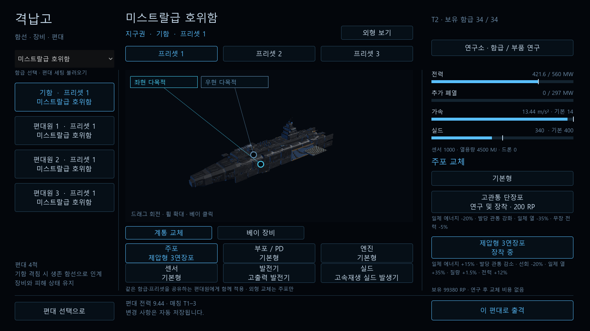
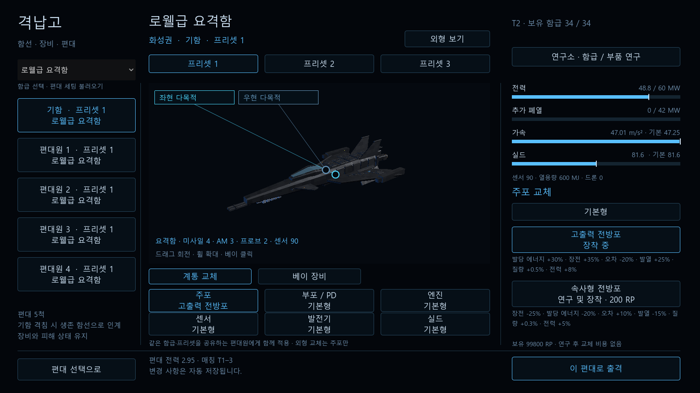
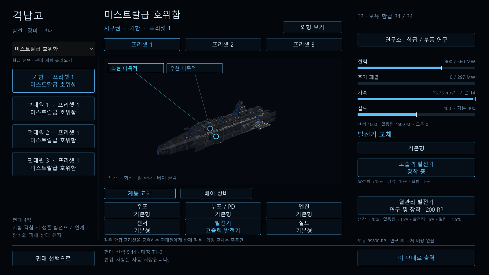
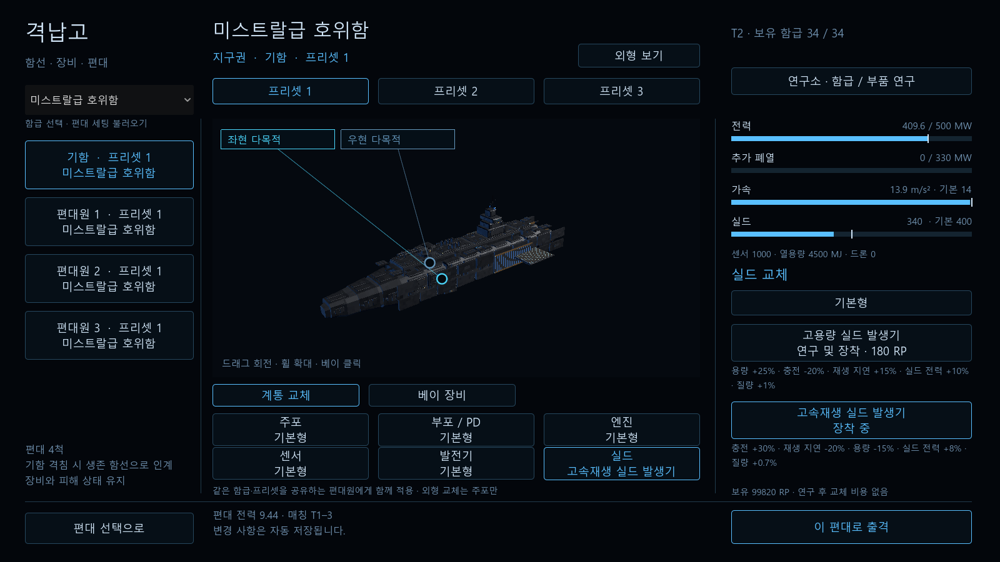

# 6계통 교체와 주포 외형 — 2026-10-16

주포·부포(PD)·엔진·센서·발전기·실드를 격납고에서 연구/교체하고 프리셋·출격에 전달한다. 외형 변화는 주포만 적용한다. 구현 계약은 [DESIGN_progression §19](../../DESIGN_progression.md#19-6계통-교체와-주포-외형-1차-구현-2026-10-16)에 있다.

## 검증 결과

- 전체 SimChecks **61묶음 / 5,677,048개 통과**. 신규 교체 검사 **1,880개**를 제외한 출력은 직전 하드포인트 단계의 전체 출력과 정확히 같다. 기존 34함급의 `ToJson()`과 기본 `LoadoutId`도 같다.
- 모든 함급의 호환 교체형, 실제 발사/탄수, 영구 연구 적용 순서, 모듈 손상·복구, 전력 초과 및 발전기 조합, 중복 연구 비용 방지, RP 부족/부적합 구매 실패 시 원상태, 프리셋 독립성, v2→v3 저장·백업, 출격 해금 검증.
- 실제 Vulkan 렌더러 모델 **3,560개**: 주포 포신 수, 선회·고각·반동·포구·섬광, 큰 좌표에서 보간 일치, 다른 5계통의 메시/변환 유지. 기본 10종 모델과 각 모델의 호환 주포를 검사했다.
- 격납고→교체 연구/장착→프리셋→매칭→전투→인계 **32개**, 기존 연구/구매/출격/결과/재출격 **30개**. 실제 플레이어 저장 대신 별도의 검사 프로필을 사용했다.
- 게임 Debug 빌드 **경고/오류 0**. 화면 4개를 읽어 설명 줄바꿈과 여섯 계통 선택, 발전기/실드 수치와 주포 외형을 확인했다.

사격 검사는 전함의 후방 포탑을 앞 포탑을 관통해 쏘게 하지 않고, 포각 내의 열린 측방으로 실제 선회시켜 진행한다. 저장 중복 키 검사는 특정 버전 문자열을 치환하던 fixture를 버전과 무관하게 중복 키를 삽입하도록 고쳤다. 모델 비교는 Godot이 매번 자동 부여하는 익명 노드 번호 대신 실제 메시 경계·변환을 대조한다.

## 화면






## 재현

저장소 루트에서:

```powershell
dotnet build SpaceFleet.csproj --no-restore
dotnet run --project tests/SimChecks -c Release -- --components
dotnet tests/SimChecks/bin/Release/net8.0/SimChecks.dll
& docs/validation/components_20261016/run-render-checks.ps1
python docs/validation/components_20261016/verify.py
```

`run-render-checks.ps1`은 실제 렌더러를 숨긴 창에서 사용하고 `shots/component-render-user`로 저장 경로를 격리한다. `-Only model-checks`, `-Only hangar-flow` 등으로 개별 실행할 수 있다. 모델 검사는 헤드리스의 MultiMesh 읽기 한계 때문에 실제 GPU 렌더러에서 실행한다.

`stock-definitions.json`은 직전 단계의 `snapshot-source.cs.txt`를 현재 Release 검사 DLL에 연결해 실행한 결과다. 이전 스냅샷과 로그는 수정하지 않았다. `verify.py`는 비교·검사 결과와 현재 관련 소스 SHA-256을 `verification.json`에 쓴다.

## 이번 결과의 한계

- 교체형 성능과 연구 가격은 시험값이다. 교체형 간 실드 소진 시간·관통/유폭률, 혼성 10:10 승률·장기 탄약 소모·대규모 성능을 비교한 결과가 아니다. 기본 세팅 회귀가 같다는 것을 신규 조합의 밸런스가 같다는 뜻으로 해석하지 않는다.
- AI 무작위 매칭은 아직 기본 계통이다. 교체형은 장단점 선택으로 처리해 별도 전력 점수 보너스를 붙이지 않았다.
- 주포는 기존 하우징을 활용한 1차 포신 메시와 고정포 가속기 블록이다. 최종 Blender 외장·채널링 레이저는 후속이다.
- 배포 EXE·ZIP, 커밋·푸시는 이번 요청에서 실행하지 않았다.
