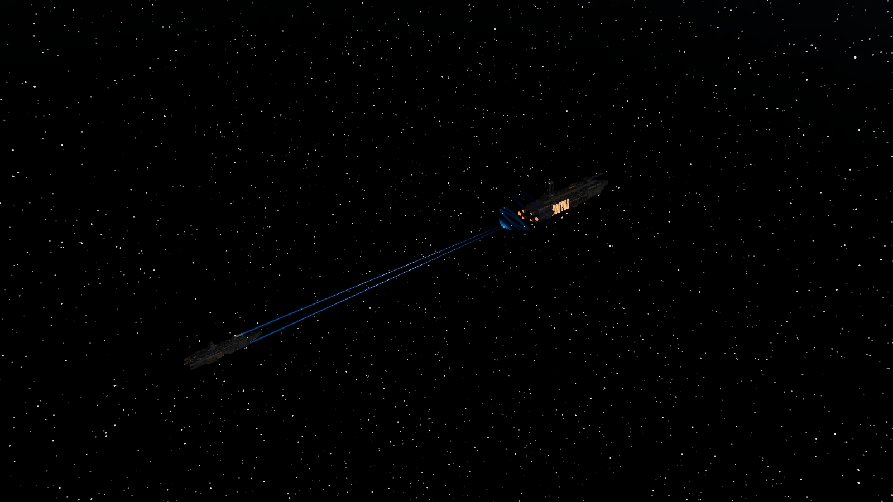
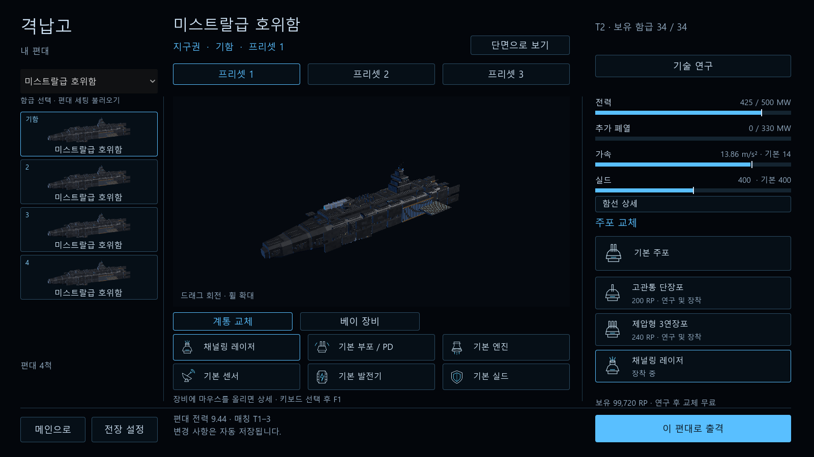

# 채널링 레이저 1차 검증 — 2026-10-17

## 사용

격납고 → 계통 교체 → 주포 → 채널링 레이저(함급별 140 RP). 34함급에서 연구/장착/저장/출격할 수 있다. 1번 주포를 선택하고 좌클릭을 유지한다. 자동 사격은 기존 B 라디얼의 교리를 따른다. 조준선 오른쪽 호는 집중, 왼쪽 호는 남은 열 여유다.

실드가 없는 같은 로컬 부위를 8초 조사하면 해당 조사기의 첫 입구 장갑 판정만 최대 75% 완화한다. 발열은 집중에 따라 최대 2.5배, 노출 신호는 2~4배. 버튼 해제·과열·가림은 집중을 약 1초 안에 없앤다. 부위/표적 변경은 새 집중을 시작한다. 기존 레일건·미사일·어뢰와 공용 탄약고의 위험은 유지한다.

## 기능 검사

- 전체 시뮬레이션 회귀: 62묶음 / 5,678,240개, `sim-final.log`. 당시 레이저 검사 225개. 이후 레이저 무장 상태/요격함 탄약 소진 오판 보완은 아래 최종 집중 검사로 재검증했다.
- 최종 레이저 검사 **226개**: `lasers.log`. 34함급 데이터/직렬화, 초당 15펄스, 탄약/탄체 없음, 1e12m 원점, 실드 경계, 국소 장갑 약화/선회/중단/리셋, 지형·아군·미사일·프로브·드론, 관측 기반 조준/데이터링크, 열·파손·복구, AI 열 관리와 무탄약 요격함 방공 유지.
- 최종 교체/연구/저장 검사 **2,237개**: `components.log`; 기존 정찰·편대/요격 임무 **142개**: `interceptor-final.log`.
- 실제 Godot RTX 2060/Vulkan 렌더: 레이저 모델·아이콘·빔·실드 경계·지속음·관전 전환·음향 중지 **17개**, `laser-test.log`. 기존 음향 **120개**, 주변 함대 음향 **120개**, `audio-test.log`, `fleet-audio-test.log`.
- 실제 게임 입력 **294개**, `weapon-input.log`: 레이저 클릭 유지/해제·무기 교체·지도·라디얼·일시정지·포커스 상실·조종 인계 및 기존 미사일/어뢰/망원/요격 조작.
- 게임 C# 빌드 경고 0, 오류 0. 최종 배포 EXE **16묶음/11,813개** 통과, ZIP 204개 항목 CRC 정상, SHA-256 및 컴파일 DLL 일치. 검사/해시는 `release.json`, 실제 EXE 로그는 `release/`에 있다.

전체 회귀의 큰 검사 수는 공간 탐색 등의 반복 조건 수를 합친 값이다. 독립된 전투나 사용자 시나리오 수를 뜻하지 않는다.

## 비용 측정

`dotnet tests/SimChecks/bin/Release/net8.0/SimChecks.dll --laser-perf`

Release, 60Hz, 90틱 준비 후 480틱 측정. 동일 호위함 24/240척, 각 2개 조사기. 열용량을 높이고 PD/드론/AI를 끈 고정 대향 배치이며 모든 조사기가 같은 틱에 펄스를 쏘는 부하 시험이다. 함선 물리·센서·충돌·레이저 피해를 포함하고 화면 렌더와 지형은 제외한다. 원자료 `performance.log`.

| 함선/조사기 | 조사 | 중앙값 ms | p95 ms | p99 ms | 최대 ms | 할당 byte/틱 |
| --- | --- | ---: | ---: | ---: | ---: | ---: |
| 24/48 | 중지 | 0.183 | 0.327 | 0.420 | 21.288 | 392 |
| 24/48 | 지속 | 0.833 | 1.819 | 2.252 | 5.320 | 10,390 |
| 240/480 | 중지 | 1.015 | 2.745 | 5.326 | 9.097 | 2,402 |
| 240/480 | 지속 | 2.847 | 12.535 | 14.642 | 19.943 | 98,928 |

240척 최대값은 60Hz 예산 16.67ms를 넘었다. 이 측정으로 240척 실제 전장의 60fps를 보장하지 않는다. 전체 AI·소행성·미사일/드론·렌더가 결합된 최악 조건, 광선 후보 탐색 및 펄스 부하 분산은 별도 성능 과제다. 측정 중 코드 빌드나 게임 검사를 겹치지 않았다.

## 화면과 음향

1600×900 실제 렌더로 빔 착점, 모델, 장비 카드 배치와 텍스트 겹침을 확인했다. 격납고 촬영은 격리된 테스트 프로필이다. 새 루프는 Agent Audio / Stable Audio 3 Medium으로 생성하고 `tools/prepare-laser-audio.py`로 원형 교차 페이드·레벨 조정을 했다. 44.1kHz 스테레오 PCM16, 2.250초, peak 0.65, RMS 0.1759, 클리핑 0, 루프 경계 차 0.00412. 프롬프트/원본/해시는 `assets/audio/laser_manifest.json`에 있다. 실제 재생·중지·관전·음성 수 제한은 검사했으며, 주관적 청음 품질은 확인하지 않았다.

## 범위

실행파일: `builds/SpaceFleet-20261017-lasers-v2-Windows-x64/SpaceFleet.exe`. 같은 이름의 ZIP은 폴더 전체를 포함한 Windows x64 휴대용 실행본이다. 첫 배포 시도에서 새 음향 루프 수를 반영하지 않은 검사 기준이 실패해 수정 후 v2에서 16묶음을 모두 재검증했다.

첫 기능 구현이며 혼성 10:10 승률·역할별 기여도·최종 DPS 균형을 확정하지 않는다. AI는 장착된 레이저를 쓰고 열 85%에서 중단/40%에서 재개하지만, 무작위 매칭의 AI 장비 배분은 기존 기본형이다. 집중 실패/잠금 위협별 세부 이탈 교리, 탄약고 재배치/축소, 최종 Blender 조사기 외장은 후속이다. 입사방위 접촉은 거리·함급·정밀 잠금을 제공하지 않는다. 설계 계약은 `docs/DESIGN_progression.md` §20.
