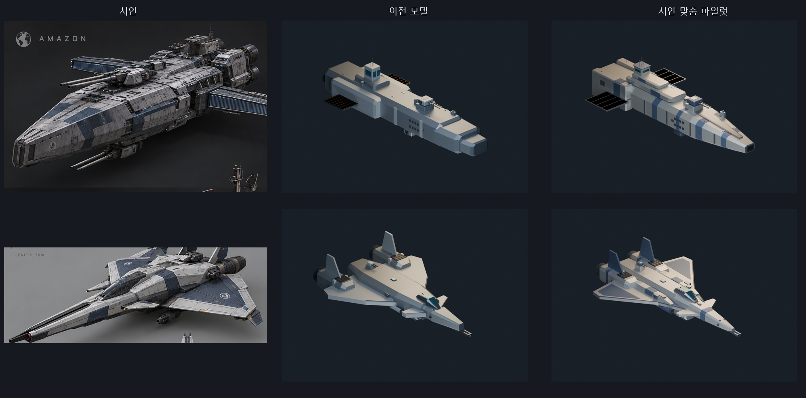
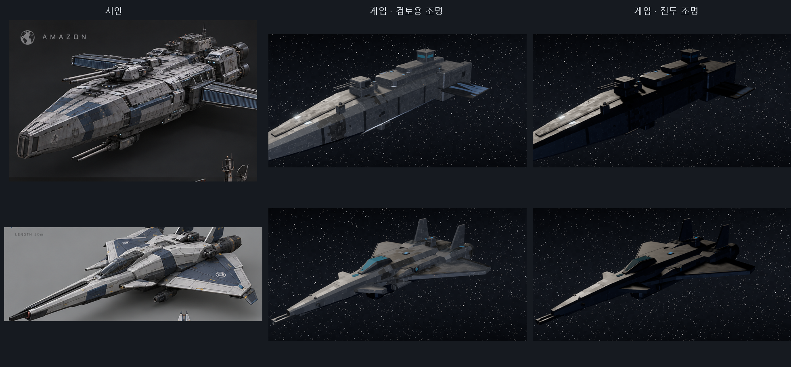

# 시안 맞춤 파일럿 — 아마존(T5 포격순양함) · 해동청(T5 요격함)

2026-10-17. 사용자 결정: 새 함급 모델을 시안 이미지에 맞추되 **파일럿 2척 먼저**, **실루엣까지**(피해 구획·모듈 좌표 포함) 바꾼다. 결과를 본 뒤 같은 방식으로 나머지 함급에 확대한다.

## 바뀐 것

| 함급 | 시안에서 가져온 형태 | 피해 구획 변화 |
|---|---|---|
| 아마존 `earth_gun_cruiser_t5` | 넓은 충각 쐐기 선수와 남색 장갑 띠, 등 쪽 능선, 계단식 포격 지휘탑, 긴 수평 방열 날개, 후방 직사각 기관 어깨와 대형 노즐 2기 | 계단 상자 3개(선수 2 + 주선체) → 선수 2·주선체·기관 어깨·지휘탑 2단·함교. 측면 장갑 어깨 상자 2개 제거. 방열판 구획 36×46 → 48×52 m(약 1.5배) |
| 해동청 `interceptor_t5` | 긴 바늘형 기수, 낮은 조종석, 양측 장갑 어깨, 꺾인 델타익과 카나드, 동체에 붙은 쌍발 나셀과 직립 쌍미익, 남색 날개 패널 | 기관을 x ±5.6 → ±3.1로 안쪽으로(강습·요격 검사 기준 \|x\|>3 유지), 어깨 구획 2개 추가, 날개 구획 4 → 6개(카나드·안쪽·바깥쪽) |

- 장갑 두께·경사, 모듈 체력·크기(아마존 방열판 제외), 무장·탄수·발사 속도, 비행 성능, 연구 수치는 바꾸지 않았다. 새 구획은 기존 구획의 장갑을 상속한다.
- 포탑 피벗·포구, PD 법선, 미사일·AM 출구는 유지했다. 아마존 상부 PD 2기는 기관 어깨 위로(x ±18 → ±22), 해동청 정찰 프로브 출구는 어깨 밖으로(x ±3.05 → ±3.4, z -0.3 → -0.5) 옮겼다.
- 도장: 지구 시안처럼 밝은 회색 선체 + 남색 띠. 아래 "표면 도장" 절 참고.

## 표면 도장 (텍스처)

게임은 이미지 텍스처가 아니라 모델 좌표 기반 절차 셰이더 `shaders/hull_panels.gdshader`로 장갑판 이음새·판 명암·작업등을 그린다. 그래서 같은 방식으로 시안의 표면을 옮겼다.

- 셰이더에 선택 항목 5개 추가: `accent_color`, `accent_ratio`, `accent_scale`(판 단위 남색 블록을 선체 길이 방향 띠로 모음), `wear`(판 가장자리 도장 벗겨짐), `streaks`(길이 방향 때 줄무늬). 기본값 0이면 기존과 같은 결과이므로 다른 32개 함급의 모습은 바뀌지 않는다.
- 함급별 값은 형상 계약 `blockout.surface`에 쓰고, 제작기가 `assets/ships/manifest.json`의 `surface`로 옮긴다. `src/View/ImportedShipModels.cs`가 이 값을 읽어 주선체(`Armor - graphite`)에 강조색, 주선체·돌출판에 벗겨짐·때를 적용한다. `export-ship-models.py`로 다시 내보내도 이 키는 유지된다.
- 파일럿 두 함급은 도장된 장갑처럼 보이도록 주선체·돌출판의 금속성을 0.7/0.52 → 0.2로 낮췄다. 금속성이 높으면 어두운 우주 배경만 반사해서 밝은 색을 칠해도 검게 보였다.
- 검토용 조명: `.\tools\gallery.ps1 <ID> hero -Studio`(`--gallery-light=studio`). 카메라 쪽 주광과 반대편 보조광을 더한다. 전투 조명은 바꾸지 않았다.
- 남은 차이: 전투 조명에서는 해를 받지 않는 면이 어둡고 AgX 톤매핑이 대비를 눌러서, 시안의 또렷한 아이보리/남색 대비가 약하다. 이건 함선이 아니라 전투 조명 전체의 문제다. 문장·글자 같은 데칼은 아직 없다.

## 도구

- `data/model_layouts/<id>.json`: 형상 계약(구획·모듈·소켓). 아마존은 `blockout.profile`, 해동청은 `blockout.shoulder/canard/wing/cockpitZ`를 추가했다.
- `tools/apply-model-layouts.py <id>...`: 계약을 기존 variant에 다시 적용한다. 장갑·성능·연구는 그대로다. 바꾸지 않은 함급(`mars_gun_cruiser_t5`, `mars_interceptor_t5`)에 실행해도 파일이 바뀌지 않음을 확인했다.
- `tools/build-reference-pilot-models.py`: 두 함선의 Blender 원본·GLB·렌더 생성. 수작업 수정 후에는 `export-ship-models.py`로 내보낸다.
- `tools/audit-t5-models.py`에 `--out`, `--only` 인자를 추가했다(기본 동작은 기존과 같다).

## 검증

- `audit.log`: 마커 좌표·엔진 노즐 가시성·미사일 출구·부품 연결 2척 통과.
- `sim--tier-branches.log` 682개, `sim--cruisers.log` 220개 통과(회전·큰 좌표에서 모든 모듈 관통 도달 포함).
- `model-test.log`: 실제 렌더러 모델 검사 10,420개 통과.
- `game-build.log`: 게임 빌드 경고·오류 0.
- `sim-all.log`: 전체 시뮬레이션 63묶음 / 5,678,991개 통과. 직전 레이저 작업의 전체 로그(`../aa_lasers_20261017/sim-all.log`)와 출력이 한 줄 빼고 모두 같다. 기존 회귀 전투에는 두 함급이 나오지 않는다. 다른 한 줄은 하드포인트 검사 수(60,623 → 67,844)인데, 이건 그 로그 뒤 레이저 커밋에서 이미 늘어난 값이다.
- 격납고 초상화 2장 재생성(`assets/ui/ships/`). 표면 도장 적용 뒤 모델 검사 10,420개를 다시 통과했고, 초상화도 다시 만들었다.

피탄 면적이 달라졌으므로 이 두 함급의 전투 결과는 바뀐다. 전투 균형 측정은 하지 않았고, 배포 EXE도 갱신하지 않았다.
